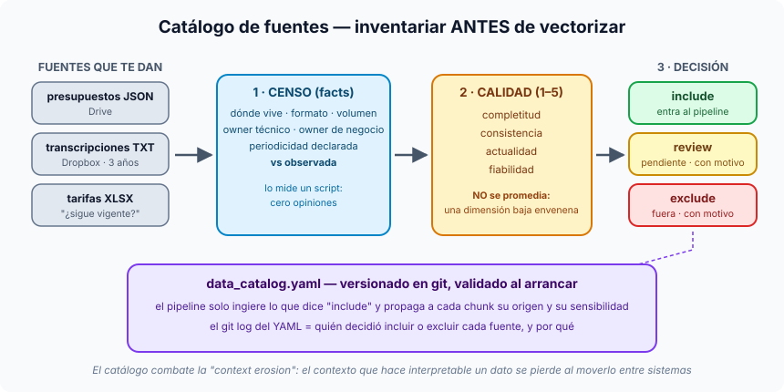

# Píldora — El catálogo de fuentes

**Un catálogo de fuentes es el inventario versionado de todos los datos que
pueden entrar a tu sistema de IA: dónde viven, quién responde de ellos, qué
calidad tienen y, sobre todo, la decisión explícita de si entran o no.** En RAG
no es documentación: es un artefacto de software que el pipeline lee al
arrancar.

## El antipatrón: vectorizar primero, mirar después

Cuando te entregan "lo que hay" (JSON en Drive, transcripciones en Dropbox, un
Excel de tarifas que nadie sabe si sigue vigente), el reflejo es ponerse a
vectorizar para ver resultados rápido. El coste es asimétrico: los errores no
salen el día 1, salen el día 60, con un pipeline ya construido encima. Tres
modos de fallo, los tres con la misma raíz (nadie miró lo que había):

- **Mezcla silenciosa de versiones**: la propuesta inicial y la firmada
  conviven en el índice, y se recupera la equivocada porque ningún metadato las
  distingue.
- **Fuentes podridas**: documentos aparentemente válidos pero obsoletos
  (tarifas de hace dos años) que producen respuestas **seguras y falsas**.
- **Gaps invisibles**: el sistema responde bien donde hay datos e inventa algo
  plausible donde no, porque nadie declaró qué preguntas no cubre el corpus.

## Los tres pasos

**1. Censo: hechos, no opiniones.** Por cada fuente: nombre lógico estable
(`historical_budgets`, no "los presupuestos viejos"), ubicación, formato,
volumen, método de acceso, *owner* técnico (a quién llamas si se cae) y *owner*
de negocio (a quién preguntas si el contenido es ambiguo). Lo más revelador es
la pareja **periodicidad declarada vs observada**: una fuente "mensual" cuya
última modificación es de hace siete meses es una fuente abandonada que alguien
cree viva. Esto lo mide un script, sin juicios.

**2. Calidad en cuatro dimensiones**, de 1 a 5:

| Dimensión | La pregunta |
|---|---|
| Completitud | ¿qué porcentaje de registros cumple el schema? |
| Consistencia | ¿el mismo concepto se escribe siempre igual? (`EUR` / `€` / `euros`) |
| Actualidad | ¿cuándo fue el último dato relevante? ¿se cumple la periodicidad? |
| Fiabilidad | ¿es fuente autoritativa o una copia derivada a mano? |

**No se promedian.** `completitud=5` con `fiabilidad=1` no es "calidad 3": son
datos completos que pueden ser mentira, que es lo peor para RAG. Cada dimensión
es condición necesaria (`is_rag_ready` exige que ninguna baje de 3).

**3. Decisión explícita: include, review o exclude.** La tercera opción
(`review`) es la que evita que todo lo dudoso se cuele en `include`. Y si no es
`include`, **el motivo es obligatorio**: en el proyecto, el modelo Pydantic no
valida un `exclude` sin `decision_reason`. Excluir es disciplina, no desidia.

## Linaje y *context erosion*

El **linaje** es el rastro de origen y transformaciones de un dato. En RAG es
condición de utilidad: si el sistema dice "un proyecto similar costó 80.000 €",
alguien preguntará de qué documento sale, de cuándo es y si era una propuesta o
un contrato firmado.

La ***context erosion*** es lo contrario: el contrato firmado el 15/03/2024
acaba como `presupuesto_v3.pdf`, luego `cliente_acme_2024.pdf`, luego
`cliente_acme.txt`… y al llegar al pipeline nadie sabe qué era. **El catálogo
existe para preservar ese contexto** por construcción.

## En nuestro proyecto (Sesión 6)

`data/catalog/catalog.yaml` con tres fuentes y las tres decisiones posibles:

| Fuente | Decisión | Motivo |
|---|---|---|
| `presupuestos_json` | include | PII confidencial, se pseudonimiza |
| `transcripciones_txt` | review | la de 2023 no tiene speaker tags y rompe el parser |
| `rate_card_xlsx` | exclude | `actuality=1`: fichero del 12/01/2024 |

El código vive en `app/ingestion/catalog/`: `inspect.py` (los facts),
`models.py` (el contrato Pydantic con las reglas) y `loader.py` (tres líneas:
todo el peso está en el modelo). El endpoint de ingesta devuelve **400** si
pides una fuente que no es `include`.

## ¿YAML en el repo o una plataforma de catalogación?

Atlan, DataHub, Collibra o Purview tienen sentido con cientos de fuentes y un
equipo de *data governance*. Con una o dos docenas de fuentes y un equipo
pequeño, el YAML versionado gana: validación en cada PR, historial en git y
cero infraestructura. Migrar después es fácil; empezar por la plataforma suele
acabar en una herramienta cara y vacía.

## En una línea

> Antes de vectorizar, inventaría: qué hay, de quién es, qué calidad tiene y
> **por qué entra o no entra**, con el motivo escrito y versionado.

Relacionadas: [decision-cag-rag-hibrido.md](decision-cag-rag-hibrido.md) ·
[limpiar-no-es-validar.md](limpiar-no-es-validar.md)
