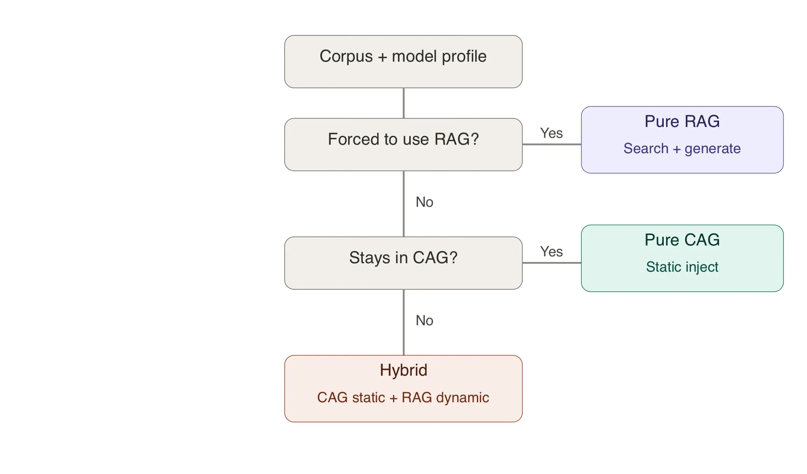

# Píldora — ¿CAG, RAG o híbrido? Cómo se decide

**La pregunta no es "¿RAG sí o no?", sino "¿se cumplen a la vez las cuatro
condiciones que hacen viable el CAG?".** Si una sola falla, el CAG no aguanta
en producción. Y entre los dos extremos hay un término medio que casi siempre
gana: el **híbrido** (lo estable en el prompt, lo volátil recuperado).



## El techo del CAG: cuatro restricciones a la vez

El reflejo de junior es buscar un único culpable ("no cabe en el contexto"). En
realidad el CAG tiene **cuatro techos que operan simultáneamente**:

| Restricción | Tipo | Qué la rompe |
|---|---|---|
| **Context window** | binaria | el corpus no cabe en la ventana del modelo |
| **Coste por consulta** | continua | los tokens de entrada se pagan en cada turno: 3 céntimos se despliega, 2 € no |
| **Latencia** | depende del producto | 100K tokens tardan segundos: inviable en un chat, irrelevante en un batch nocturno |
| **Lost in the middle** | silenciosa | aunque quepa, el modelo atiende peor lo que está en el centro del contexto |

La cuarta es la más peligrosa porque **no se ve**: el modelo siempre responde
algo plausible. Solo aparece si mides el recall de un dato que colocaste a
mitad del contexto.

En código es un `AND`, no un `OR` (así lo modela `app/ingestion/architecture.py`
en la Sesión 6):

```python
@dataclass
class CAGViability:
    fits_in_context_window: bool
    cost_per_query_acceptable: bool
    latency_acceptable: bool
    quality_holds_with_load: bool

    def is_viable(self) -> bool:
        return all([self.fits_in_context_window, self.cost_per_query_acceptable,
                    self.latency_acceptable, self.quality_holds_with_load])
```

## Los cuatro ejes de la decisión

Lo que hay que poder defender, con números, ante un Director de Producto:

1. **Volumen** del corpus frente a la ventana del modelo (con margen: llenar el
   95 % es posible pero degrada la calidad; el proyecto usa un 70 % útil).
2. **Frecuencia de actualización**: si cambia cada día, la caché de prefijo no
   llega a amortizarse.
3. **Trazabilidad**: si hay que citar la fuente de cada afirmación, necesitas
   fragmentos identificables, no un prompt gigante.
4. **Control de acceso**: si cada usuario solo puede ver sus datos, no puedes
   meter el corpus entero en el mismo contexto.

## El caso del proyecto (Proyecto 2)

| Dato | Valor |
|---|---|
| Volumen | ≈ 250 000 tokens |
| Ventana de gpt-4o-mini | 128 000 tokens |
| Refresco | semanal |
| Trazabilidad | obligatoria (contractual) |
| Acceso | por usuario |

Resultado: tres restricciones en rojo (`context_window`, `latency`,
`lost_in_the_middle`) y dos ejes que el CAG puro no resuelve → **RAG**, con una
capa residual de CAG para lo estable.

## ¿Y el fine-tuning?

**No está en el árbol, y es a propósito.** No es una alternativa a RAG: es una
capa **ortogonal** que se suma encima cuando el problema es *cómo* responde el
modelo (estilo propio de la empresa, terminología, un formato que no respeta),
no *qué datos* tiene. Regla práctica:

- Lo recuperado es correcto pero se presenta mal → fine-tuning puede ayudar.
- La respuesta ya es buena con los fragmentos correctos → no lo necesitas.
- **Nunca** como sustituto de un retrieval mal diseñado: le estarías enseñando
  a memorizar lo que debería estar buscando.

## En una línea

> CAG si las cuatro restricciones están en verde; RAG si alguna se rompe;
> **híbrido** cuando parte del conocimiento es estable y parte volátil. El
> fine-tuning va aparte.

Relacionadas: [cag.md](cag.md) · [rag.md](rag.md) ·
[catalogo-de-fuentes.md](catalogo-de-fuentes.md)
