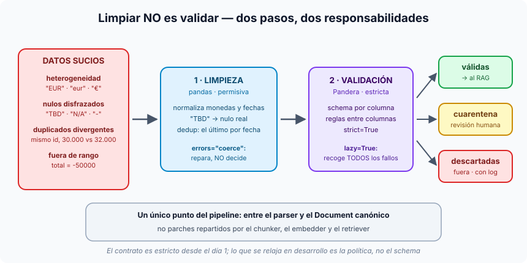

# Píldora — Limpiar no es validar

**Pydantic garantiza la *forma* de un documento; Pandera garantiza su
*contenido*.** Y entre medias hay dos pasos que conviene no mezclar: la
**limpieza**, permisiva, que repara lo reparable, y la **validación**,
estricta, que decide qué entra al RAG, qué va a revisión y qué se tira.



## El problema: datos válidos que rompen el RAG

Dos documentos pueden cumplir perfectamente el contrato de Pydantic y aun así
ser incompatibles:

- `"ACME Corp."` y `"Acme Corp"` son strings válidas, pero el embedding los
  trata como entidades distintas y el retrieval falla en silencio.
- `total_amount: -50000` es un número válido que rompe cualquier análisis.
- `"15/03/2024"` y `"2024-03-15"` son strings válidas y distintas para un
  filtro por fecha.

## Las cuatro familias de suciedad

| Familia | Ejemplo | Por qué hace daño |
|---|---|---|
| **Heterogeneidad de formato** | `EUR` · `eur` · `€` · `euros` | cada variante es un token distinto: el mismo cliente acaba en regiones lejanas del espacio vectorial |
| **Nulos disfrazados** | `"TBD"`, `"N/A"`, `"-"`, `"pendiente"` | pasan la validación de tipo y se vectorizan como si fueran contenido real |
| **Duplicados con divergencias** | el mismo presupuesto con 80.000 € (ERP) y 82.500 € (copia manual) | se recupera el que se indexó primero; respuestas inconsistentes que parecen "ruido del LLM" |
| **Fuera de rango** | importes negativos, fin antes que inicio | rara vez se recuperan, pero cuando sí, dan respuestas muy seguras sobre absurdos |

## Paso 1 · Limpiar (pandas): repara, no juzga

Transformaciones pequeñas, testeables por separado y en orden (nulos antes que
dedup, formatos antes que validar):

```python
df["signed_at"] = pd.to_datetime(df["signed_at"], errors="coerce", dayfirst=True)
df = (df.sort_values(["budget_id", "signed_at"])
        .drop_duplicates(subset=["budget_id"], keep="last"))
```

- `errors="coerce"` convierte lo irreparable en nulo (`NaT`) en vez de lanzar
  una excepción: la limpieza **no decide**, eso lo hace la validación.
- "Quédate con el último por fecha" es una **política de negocio**, no una
  decisión técnica: va documentada en el código.

## Paso 2 · Validar (Pandera): el contrato de contenido

Lo que Pydantic hace con un objeto, Pandera lo hace con un DataFrame entero,
columna a columna, y al fallar te dice **qué filas, en qué columna y por qué**:

```python
import pandera.pandas as pa            # Pandera v2 (no `import pandera as pa`)

"total_amount": Column(float, checks=[Check.ge(0), Check.le(10_000_000)]),
"currency":     Column(str, checks=Check.isin(["EUR", "USD", "GBP"])),
# strict=True: una columna no declarada es un fallo
# coerce=False: aquí se comprueba, no se transforma
```

Y se valida con `lazy=True` para recoger **todos** los errores a la vez (sin
eso, solo verías el primero y no podrías repartir las filas).

## Paso 3 · La política: reparar, cuarentena o descartar

| Acción | Cuándo | Ejemplo |
|---|---|---|
| **Reparar** | se arregla sin perder significado, sin humano | `"euros"` → `EUR` |
| **Cuarentena** | grave, pero útil tras revisión: no entra al RAG, se guarda con su motivo | un campo obligatorio vacío con el resto completo |
| **Descartar** | contaminación clara: fuera, con log | importe negativo, id con formato imposible |

La política es **explícita y documentada**, nunca implícita en un `if` perdido.

## Lo que se ve en la demo de la sesión

De 6 ficheros salen 5 filas (el dedup fusiona las dos versiones de
`BUDGET-2024-0005`): 3 válidas, 1 en cuarentena y 1 descartada (el −50000).

La que va a cuarentena es `BUDGET-2024-0002`, por su fecha `12/03/2024`. pandas
deduce el formato a partir de la primera fila (`2024-05-02`), la del 0002 no
encaja y queda como nula; entonces falla la regla de "fecha obligatoria". Es
justo la lección: **la limpieza no pudo repararla y la validación la cazó**.

## Tres reglas para llevarse

1. **Un único punto** del pipeline (entre el parser y el `Document`), no parches
   en el chunker, el embedder y el retriever.
2. **El contrato es estricto desde el día 1**; en desarrollo lo que se relaja es
   la política (más cuarentena, menos descarte), nunca el schema.
3. **Normalizar con bisturí, no con motosierra**: pasar todo a minúsculas
   arregla `ACME` frente a `acme`, pero borra la diferencia entre "Apple" la
   empresa y "apple" la fruta.

Relacionadas: [catalogo-de-fuentes.md](catalogo-de-fuentes.md) ·
[pii-pseudonimizacion.md](pii-pseudonimizacion.md)
