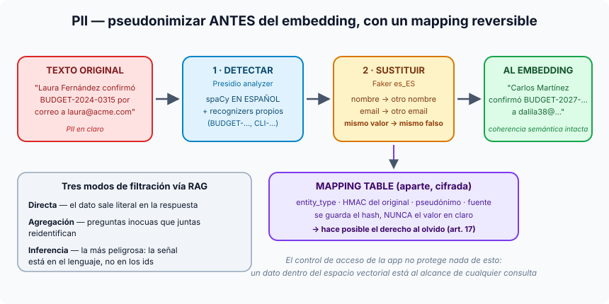

# Píldora — PII, pseudonimización y GDPR en RAG

**En un sistema RAG, la protección de los datos personales tiene que ocurrir
antes del embedding, no en la respuesta.** La técnica que mejor funciona es la
**pseudonimización reversible**: cambiar cada dato sensible por uno falso pero
verosímil, siempre el mismo para el mismo valor, y guardar la correspondencia
aparte en una *mapping table*.



## Por qué el control de acceso no basta

En una base de datos relacional, si la columna `email` está protegida, no hay
consulta SQL que la devuelva. En RAG el usuario no consulta tablas: hace
preguntas en lenguaje natural, el sistema recupera los fragmentos más
parecidos y el modelo los usa para responder. **Si el fragmento contiene el
dato, el modelo lo va a usar.** El vector no sabe qué es sensible, así que no
hay permiso que lo oculte.

## Tres modos de filtración

Ninguno necesita acceso de administrador: bastan credenciales normales y
preguntas inocentes.

1. **Directa**: "¿qué clientes nos contrataron migraciones a cloud?" → la
   respuesta enumera nombres reales porque están literalmente en los chunks.
2. **Por agregación**: preguntas sueltas e inocuas ("proyectos de 2024", "el
   más caro", "su sector") que juntas reconstruyen el mapa de clientes.
3. **Por inferencia**, la más peligrosa: aunque cambies los nombres, el
   contexto (sector, importes, fechas, geografía, forma de hablar) puede bastar
   para identificar a alguien. Pseudonimizar no la frena del todo.

## GDPR en cuatro ideas

- **Dato personal** es cualquier cosa que identifique a una persona, directa o
  indirectamente: también una IP, un número de empleado o una combinación de
  datos inocentes.
- **Anonimizar** (irreversible) saca el dato del ámbito de GDPR; **pseudonimizar**
  (reversible, con un mapping guardado aparte) sigue siendo dato personal, pero
  se gestiona mucho mejor.
- **Derecho al olvido (art. 17)**: en una base de datos es un `DELETE`; en RAG,
  el dato está repartido en miles de chunks vectorizados. Sin un registro de qué
  chunks mencionan a quién, borrar es imposible.
- **Minimización**: procesa solo lo necesario. ¿El estimador necesita el nombre
  real del cliente? No: necesita el sector, el alcance y las tecnologías.

## Por qué pseudonimizar y no poner `[PERSON]`

Sustituir por etiquetas genéricas parece más seguro, pero degrada los
embeddings: en pruebas, la similitud cae entre un **15 y un 25 %**. Un nombre
falso pero verosímil y **consistente** ("Juan García" pasa a ser "Carlos
Martínez" en todos los documentos) conserva la estructura semántica.

## Cómo se hace en el proyecto (Sesión 6)

**1. Detectar con Presidio, en español.** Por defecto Presidio usa un modelo
de spaCy en inglés y, sobre nombres hispanos como "Laura Fernández", devuelve
cero entidades. Y **falla en silencio**. Por eso se configura explícitamente:

```python
provider = NlpEngineProvider(nlp_configuration={
    "nlp_engine_name": "spacy",
    "models": [{"lang_code": "es", "model_name": "es_core_news_md"}],
})
engine = AnalyzerEngine(nlp_engine=provider.create_engine(), supported_languages=["es"])
engine.registry.add_recognizer(BudgetIdRecognizer())    # \bBUDGET-\d{4}-\d{4}\b
engine.registry.add_recognizer(ClientCodeRecognizer())  # \bCLI-\d{4}\b
```

Los identificadores propios del negocio (ids de presupuesto, códigos de
cliente) no los conoce nadie más que tú: hay que enseñárselos con
*recognizers* propios, o se vectorizan en claro.

**2. Sustituir con Faker, siempre igual.** Un generador por tipo de entidad
(nombre por nombre, email por email), reemplazando de derecha a izquierda para
que no se desplacen las posiciones del texto.

**3. Guardar el mapping aparte.** En la tabla `pseudonym_mappings` se guarda el
**HMAC** del valor original, nunca el valor en claro, con una restricción
`UNIQUE (entity_type, original_hash)` que hace segura la concurrencia sin
bloqueos.

## El derecho al olvido, paso a paso

1. Buscar en la mapping table los pseudónimos de la persona (y sus variantes).
2. Localizar en el índice los chunks que los contienen.
3. Eliminar esos chunks del índice.
4. Borrar sus entradas del mapping: si vuelve a aparecer, recibe un pseudónimo
   nuevo sin relación con el anterior.
5. Dejarlo registrado en un log de auditoría.

## Falsos positivos: el precio del español

`es_core_news_md` a veces marca como persona palabras comunes ("Mar", "Sol",
"Cruz", "Alba"); en la demo de la sesión, un código de cliente acaba sustituido
por un nombre. No es un bug: es el *trade-off* de Presidio en español. Se
mitiga subiendo el umbral de confianza, con una lista de palabras excluidas o
con un modelo más grande (`es_core_news_lg`).

## En una línea

> Pseudonimiza antes de vectorizar, de forma consistente y con un mapping
> reversible guardado aparte: es lo que hace el corpus usable **y** borrable.

Relacionadas: [limpiar-no-es-validar.md](limpiar-no-es-validar.md) ·
[rag.md](rag.md)
