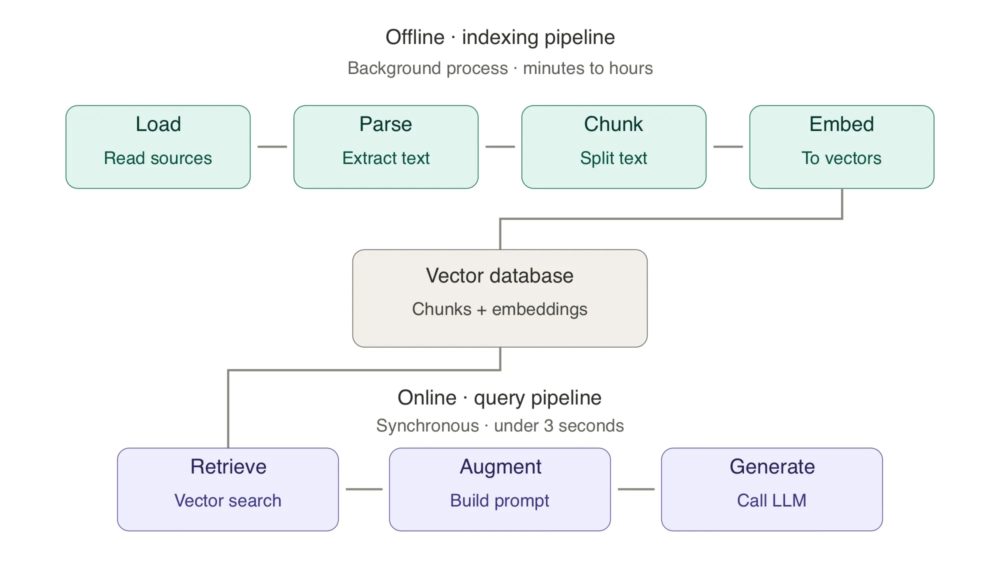

# Sesión 06 — Fundamentos de data-driven AI (contexto)

> Fichero de contexto para preparar la clase. Recoge la descripción oficial de la sesión,
> la guía del ejercicio previo y cómo encaja con las ramas del repo.

- **Vídeo (Vimeo):** https://vimeo.com/1194693463/b5b293b513
- **Ramas del repo:** `session_06` (punto de partida) y `session_06_live` (estado final del directo)
- **Calendario:** Sesión 6 - Data-driven AI: análisis y normalización (cohorte AI Engineering 2609)

---

## 1. Tesis de la sesión

**Los sistemas RAG no fallan en producción por culpa del modelo de embeddings, ni de la base
vectorial, ni de la estrategia de retrieval. Fallan por los datos.**

La sesión abre el módulo de data-driven AI. Ningún chunking inteligente, reranker ni
cross-encoder arregla un corpus mal auditado. Antes de tocar un modelo de embeddings hay cuatro
decisiones operativas que casi ningún tutorial cuenta, y que separan un sistema que hace buena
demo de uno que aguanta seis meses en producción.

## 2. Lo que se descubre en la sesión

1. **Cuándo el salto de CAG a RAG es una necesidad arquitectónica, no una preferencia.**
   El ejercicio previo estresa el CAG contra un corpus realista. Así el alumno llega con números
   propios y ve en qué eje se rompe: ventana de contexto, coste, latencia o degradación de la
   atención en contextos largos.
2. **El catálogo de fuentes como artefacto vivo del proyecto.** Auditoría e inventario de los
   datos de la empresa, decisiones explícitas de inclusión y exclusión, evaluación de calidad por
   dimensiones ortogonales y un YAML versionado que el pipeline lee directamente. La disciplina
   arquitectónica se cumple por construcción.
3. **Ingesta multi-formato con un contrato común.** Tres capas (loaders, parsers, normalizers)
   que producen un `Document` canónico venga de JSON, PDF, DOCX, XLSX o una transcripción.
   Estrategia por formato y criterios honestos para elegir entre parsers nativos y `unstructured`.
4. **Limpieza y validación como guardián del corpus.** Pandera como contrato de datos sobre el
   DataFrame intermedio, política explícita de reparar / cuarentena / descartar, y por qué validar
   es trabajo de un módulo dedicado y no de parches repartidos por chunker, embedder y retriever.
5. **PII, anonimización y GDPR antes del embedding.** Tres formas de filtrar información sensible
   vía RAG que los controles de acceso tradicionales no previenen, pseudonimización reversible con
   Presidio y Faker, la tabla de mapeo como pieza que sostiene el derecho al olvido, y el marco
   GDPR mínimo para cualquier sistema empresarial.

---

## 3. Ejercicio previo — estresar el CAG

Hasta la sesión 5 el sistema es **CAG (Cache-Augmented Generation)**: cada turno inyecta en el
prompt `[summary] + anchors + ventana_deslizante + ProjectMetadata + tier + transcript +
texto_extraído_de_adjuntos`. Todo cabe en el contexto por construcción, mientras los proyectos
sean cortos y los adjuntos modestos.

Nunca se ha probado en serio: no se sabe en qué turno olvida el nombre del proyecto, cuánto
cuesta el turno 10 frente al 1, ni a qué tamaño de adjunto la latencia P95 supera el SLA. El
ejercicio instrumenta el CAG, lo somete a tres escenarios de carga (multi-turno largo, adjuntos
grandes, ráfagas) y produce un `REPORT.md` con tres curvas y dos párrafos de lectura: el
**baseline cuantitativo** contra el que se compara RAG en el directo.

### Punto de partida (tras la sesión 5)

- Servicio IA conversacional con sesiones en memoria, ventana deslizante
  (`MAX_CONVERSATION_TURNS=6`), anclas heurísticas, summarizer acumulativo, `ProjectMetadata`
  extraído turno a turno, tier dinámico y Actor-Critic-Boss opcional.
- Adjuntos PDF/DOCX por `multipart/form-data` con extracción local de texto (camino B).
- Framework de evals con 16 casos golden (`evals/golden_dataset.json`), tres métricas binarias
  (`SchemaAdherenceMetric`, `CostBoundsMetric`, `ContentRecallMetric`) y runner CLI
  (`evals/run.py`) con modos `actor` y `acb`.
- Wrapper LLM observable: cada llamada devuelve `latency_ms`, `tokens_in`, `tokens_out`,
  `cost_usd`, `model`, `provider`. Precios en `app/services/llm_wrapper.py` (`MODEL_COSTS`).
- Endpoint de debug `GET /sessions/{id}` con `message_count`, `anchors_count`, `summary_chars`,
  `last_resolved_tier`, `last_tier_rule`.

Todo se apoya en esta base; no se reescribe nada.

### Objetivos de aprendizaje

- **Fallar duro vs degradar en silencio.** El esquema rompe y el CI avisa, frente a un recall que
  baja del 90 % al 60 % sin ningún test en rojo. Cuál es más peligroso en CAG y por qué.
- **Extender un framework de evals sin reescribirlo.** El patrón `MetricResult` +
  `run_all_metrics` ya existe; una métrica nueva son ~15 líneas.
- **Los presupuestos son contratos de diseño**, no algo que se mira después.
  `LatencyBudgetMetric(budget_ms=4000)` convierte el SLA en un test.
- **Las tres curvas canónicas** de cualquier sistema basado en contexto: latencia vs tokens,
  coste acumulado vs turnos, recall de hechos vs longitud del historial.
- **"El contexto está lleno" es una decisión arquitectónica**, no un error del LLM: el momento
  exacto en que CAG empieza a perder frente a RAG.

### Los cinco bloques

**Bloque 1 — Un único evento de observación por turno.** Hoy hay logs sueltos (`cache_hit`,
`llm_call_completed`, `history_compressed`, `summarizer_completed`,
`session_estimate_received`). Se unifican en un evento `turn_observed`, emitido en
`EstimationService.estimate_conversational()` justo antes del `return`, con estos 13 campos:

| Campo | Notas |
|---|---|
| `turn_index` | 1-based, dentro de la sesión |
| `session_id` | |
| `enriched_transcript_chars` | transcript + adjuntos concatenados |
| `attachments_total_chars` | 0 si no hay |
| `messages_in_window` | `len(history.messages)` tras compresión |
| `anchors_count` | |
| `summary_chars` | |
| `tokens_in` / `tokens_out` | |
| `cost_usd` | |
| `latency_ms` | |
| `cache_hit_kind` | `none` / `exact` / `semantic` |
| `last_resolved_tier` | |

**Bloque 2 — Escenarios sintéticos multi-turno** (`evals/stress/scenarios.py`), con
N ∈ {1, 3, 6, 10, 20}. Tres perfiles:

- *Proyecto que crece*: se añaden requisitos coherentes (auth, multi-tenant, audit log, export
  CSV…). Mide el coste y si el `project_name` sobrevive al turno 20.
- *Proyecto que pivota*: en el turno 5 cambia el stack (React → Flutter). Mide si la metadata se
  actualiza limpia o si `mentioned_technologies` acumula ambos.
- *Proyecto que se contradice*: turno 3 "presupuesto 30k€", turno 8 "80k€". Mide cuál se
  conserva, cuál pasa a ancla y cuál acaba en el summary.

Cada perfil declara un **fact-tracker** (qué debe recordarse en cada turno) que alimenta
`MemoryDriftMetric`.

**Bloque 3 — Adjuntos grandes.** PDFs sintéticos de 0, 5, 20, 50 y 100 KB (el último cerca del
tope `MAX_ATTACHMENT_CHARS=60.000`, para ver cómo trunca). Misma estimación inicial; el estrés
está en el adjunto. Se miden latencia, coste y recall del contenido del adjunto en el `summary`.

**Bloque 4 — Tres métricas nuevas:** `LatencyBudgetMetric`, `CostBudgetMetric` y
`MemoryDriftMetric`, siguiendo el patrón `MetricResult` (`name`, `score`, `passed`, `details`).
Determinismo antes que sofisticación: nada de embeddings ni LLM-as-judge, match exacto
(sin distinguir mayúsculas) sobre los campos del snapshot. Van en `evals/metrics.py` o en
`evals/stress/metrics.py` (hay que justificar la elección).

**Bloque 5 — Runner y reporte.**

```bash
uv run python -m evals.stress.run --http http://localhost:8000 \
    --scenarios growing,pivot,contradiction \
    --attachment-sizes 0,5,20,50,100 \
    --repeats 3 \
    --output evals/stress/results.csv
```

Reusa el patrón de `evals/run.py` (httpx en `--http`, `TestClient` in-process). Escribe un CSV
con una fila por turno: todas las columnas de `turn_observed` más una por métrica binaria.

### Lo que NO entra

| Tentación | Por qué no |
|---|---|
| Implementar RAG | Es el directo; la gracia es comparar contra el baseline |
| Optimizar el CAG (acortar el system, comprimir más, bajar `MAX_CONVERSATION_TURNS`) | El ejercicio mide, no optimiza; tocar una constante invalida la comparación |
| Comparar proveedores (gpt-4o-mini vs claude-haiku-4-5) | Fuera de alcance; un único proveedor para curvas comparables |
| Notebook con matplotlib | El entregable es Markdown + CSV; sin dependencias gráficas |
| Persistir resultados en Postgres / SQLite | CSV en `evals/stress/results.csv` |
| LLM-as-judge para `MemoryDriftMetric` | Determinismo > sofisticación |
| UI o panel nuevo | El reporte en Markdown basta |

No hay rama `solutions/session-06`: cada alumno produce un reporte distinto y la "lectura
ejemplar" se enseña en directo con los reportes que lleguen.

### Pasos guiados

1. **Shape de `turn_observed` y emisión** en `app/services/estimation.py`. Pregunta para clase:
   ¿por qué un evento agregado es mejor que cinco logs sueltos? (CSV de una pasada, correlación
   directa entre `messages_in_window` y `cost_usd`, sin reconciliar timestamps).
2. **Tres perfiles** en `evals/stress/scenarios.py`, como listas de
   `(turn_index, transcript, fact_to_remember)`. Facts cortos: "project name: Nimbus",
   "stack includes Flutter", "budget locked: 30000 EUR".
3. **Corpus de adjuntos**: `evals/stress/fixtures/build_pdfs.py` genera `attach_5kb.pdf` …
   `attach_100kb.pdf` (reportlab o fpdf2). No se commitean los PDFs, solo el script (son
   deterministas).
4. **Las tres métricas**, con tests en `tests/test_stress_metrics.py`: una que pasa, una que
   falla y una con datos límite. Si van en `evals/metrics.py`, re-exportarlas en
   `evals/__init__.py`.
5. **Runner** en `evals/stress/run.py`: por escenario × tamaño × repetición, crea sesión
   (`POST /sessions`), lanza cada turno (`POST /sessions/{id}/estimate`), obtiene
   `turn_observed` (parseando logs del estimator o exponiéndolo en `GET /sessions/{id}`; hay que
   justificar) y evalúa las métricas con el snapshot.
6. **`evals/stress/REPORT.md`** (1–2 páginas):
   - Tabla resumen por escenario × tamaño: P50/P95 de latencia, coste total, hit rate de cache
     exacta y semántica, recall medio del fact-tracker.
   - Tres curvas en tabla: `latency_ms` vs `tokens_in`, `cost_usd` acumulado vs `turn_index`,
     `MemoryDriftMetric` vs N.
   - Dos párrafos: ¿en qué turno empieza a romperse el CAG? ¿qué domina la degradación
     (latencia, coste o memoria)? ¿qué caso límite justifica saltar a RAG?

### Criterios de "hecho"

- Cada `POST /sessions/{id}/estimate` emite `turn_observed` con los 13 campos.
- `uv run python -m evals.stress.run --http http://localhost:8000` corre de principio a fin y
  deja un CSV de **≥ 50 filas**.
- `LatencyBudgetMetric`, `CostBudgetMetric` y `MemoryDriftMetric` existen con tests en verde.
- `REPORT.md` tiene la tabla, las tres curvas y los dos párrafos con al menos una afirmación
  cuantitativa ("a partir del turno N=12 el recall del project_name cae bajo el 60 %",
  "el turno 20 cuesta X veces el turno 1").
- Todo está en el repo, no solo en local.

---

## 4. Cómo encaja con el repo (notas para preparar la clase)

- El **ejercicio previo** (estrés del CAG, `evals/stress/`) es lo que traen los alumnos.
- El **directo** (`session_06_live`) implementa la parte de datos: catálogo YAML de fuentes,
  ingesta multi-formato (loaders/parsers/normalizers), limpieza con política
  reparar/cuarentena/descartar, pseudonimización con Presidio + Faker y tabla de mapeo, endpoint
  de ingesta y `scripts/preflight_s06.py` (comprobación previa a la clase).
- Variables nuevas de la S6 en `.env.example`: `DATABASE_URL`, `CATALOG_PATH`,
  `INGESTION_DATA_ROOT`, `PRESIDIO_SPACY_MODEL`, `PSEUDONYM_FAKER_LOCALE`, `PSEUDONYM_HASH_SALT`.
- Para levantarla en local: la rama arrastra torch con CUDA y necesita el parche
  `TORCH_CPU_ONLY`; usa los mismos nombres de contenedor y puertos que la S14 (parar antes ese
  stack).

## 5. Material de los artículos (base para píldoras y diapos)

### 5.1 Por qué se rompe el CAG: las cuatro restricciones

El alumno llega del ejercicio previo viendo que su CAG "funcionaba" y con un corpus realista ha
alucinado, ha respondido con seguridad sin datos, ha tardado 15 s o ha costado 2 € por respuesta.
El artículo no explica qué es RAG: explica **por qué el CAG se rompe por donde se rompe** y da un
marco de decisión defendible ante cualquier stakeholder. Aplicar RAG es lo fácil; lo difícil es
saber cuándo aplicarlo, cuándo no y cuándo combinarlo.

El techo del CAG no es solo el context window. Son **cuatro restricciones a la vez**:

1. **Context window** — binaria y obvia: si el corpus no cabe, no se puede inyectar.
2. **Coste por consulta** — continua; crece lineal con los tokens de entrada. 3 céntimos por
   consulta es desplegable; 2 € no. Suele matar el proyecto antes que la primera.
3. **Latencia** — procesar 100K tokens lleva varios segundos. Inviable para un asistente
   síncrono, irrelevante para un batch nocturno. Depende del producto, no de la arquitectura.
4. **Degradación de atención en contextos largos** (*lost in the middle*) — la más subestimada.
   Lo que está a mitad del contexto se recupera peor que lo de los extremos: aunque el corpus
   *quepa*, no se procesa con la calidad de inyectar solo lo relevante.

```python
from dataclasses import dataclass

@dataclass
class CAGViability:
    fits_in_context_window: bool      # ¿Cabe técnicamente?
    cost_per_query_acceptable: bool   # ¿Es viable económicamente?
    latency_acceptable: bool          # ¿Responde dentro del SLA del producto?
    quality_holds_with_load: bool     # ¿La calidad se mantiene con el corpus completo?

    def is_viable(self) -> bool:
        return all([
            self.fits_in_context_window,
            self.cost_per_query_acceptable,
            self.latency_acceptable,
            self.quality_holds_with_load,
        ])
```

Con `CAG_LIMITS.md` relleno con números reales el alumno tiene los cuatro booleanos. Basta con que
falle uno para que no sea viable en producción, y casi nunca falla solo uno.

### 5.2 La calidad del dato es la variable de control

*"No amount of clever chunking or fancy architecture can fix fundamentally bad data"* (Towards
Data Science). Por eso el Módulo 3 dedica tres sesiones a datos antes de tocar embeddings.

- Un RAG no genera información: la **recupera y la presenta**. Ruido recuperado = ruido bien
  formateado; dato desactualizado = desinformación con apariencia de autoridad.
- El equipo que llega a producción invierte semanas en auditar, normalizar y validar antes de
  vectorizar. El que no, vectoriza ya y pasa seis meses sin entender por qué falla a ratos.
- Lo traicionero: **al principio parece funcionar** (corpus pequeño, queries elegidas por el
  equipo). La degradación llega cuando el corpus crece, los usuarios reales preguntan cosas no
  previstas y los datos se contradicen (dos versiones del mismo presupuesto en el índice).

### 5.3 El pipeline RAG en seis pasos y la línea offline / online



Descomposición canónica (Databricks): **1. Ingest → 2. Parse → 3. Chunk → 4. Embed →
5. Retrieve → 6. Generate**. La trampa es leerlo como un flujo lineal en tiempo real. Son **dos
pipelines** distintos — la primera decisión arquitectónica seria del Módulo 3:

| | Pipeline **offline** de indexación | Pipeline **online** de consulta |
|---|---|---|
| Pasos | 1–4 (ingest → parse → chunk → embed) | 5–6 (retrieve → augment → generate) |
| Cuándo | En background, sin usuario esperando | Síncrono, cuando el usuario pregunta |
| Presupuesto | Minutos u horas | Típicamente < 3 s |
| Disparo | Eventos: nuevo documento, cron nocturno, refresco semanal | Cada consulta |
| Puede usar | Modelos pesados (OCR, embeddings grandes, validadores estrictos) | Solo búsqueda vectorial rápida + prompt + LLM |
| Acceso | Datos crudos | Solo vectores y metadatos ya indexados |

- En el servicio IA se materializa como **dos endpoints con responsabilidades disjuntas**, no uno
  que lo hace todo. Mezclarlas es uno de los antipatrones más comunes.
- El backend de negocio (Rails u otro) invoca al servicio por dos vías: **indexación asíncrona**
  (dispara y olvida, o consulta el estado) y **query síncrona y bloqueante**. Si no está claro
  desde el día 1, el servicio se cuelga indexando 200 PDFs mientras atiende una consulta.

### 5.4 La decisión arquitectónica: CAG, RAG, híbrido y fine-tuning


Cuatro ejes que hay que poder defender con números ante un Director de Producto:

1. **Volumen del corpus** relativo al context window (con margen: llenar el 95 % es posible pero
   degrada la calidad).
2. **Frecuencia de actualización** de los datos.
3. **Requisito de trazabilidad** (¿hay que citar la fuente de cada afirmación?).
4. **Sensibilidad de los datos** (PII, control de acceso por usuario).

Árbol: corpus + perfil del modelo → ¿obligado a RAG? **Sí → RAG puro** (buscar + generar).
No → ¿se queda en CAG? **Sí → CAG puro** (inyección estática). **No → híbrido** (CAG estático +
RAG dinámico).

**Fine-tuning no es alternativa a RAG**: es una capa que se suma encima (de RAG o de CAG) cuando
el problema es el estilo de respuesta propio de la empresa, terminología que el modelo base no
maneja o un formato estructurado que no respeta. Si lo recuperado es correcto pero se presenta
mal, sí; si la respuesta ya es buena, no. **Nunca** como sustituto de un retrieval mal diseñado:
le enseñas a memorizar lo que debería estar buscando.

Decisión para el proyecto: **RAG con una capa residual de CAG**. Y antes del primer loader o de
instalar pgvector, un artículo más: el inventario.

### 5.5 Auditoría e inventario de fuentes

**El escenario:** presupuestos en JSON en Drive, tres años de transcripciones en Dropbox (algunas
`meeting_final_v3_FINAL.txt`), plantillas DOCX en Git, un Excel de tarifas de hace dos años que
nadie sabe si sigue vigente, una API interna documentada en un Confluence abandonado. ¿Por dónde
empiezas? **Por el inventario, no por vectorizar.**

**El antipatrón — vectorizar primero, mirar después.** El sesgo por la acción visible tiene aquí
coste asimétrico: los errores no salen el día 1, salen el día 60. Tres modos de fallo con la misma
raíz (nadie miró lo que había):

- **Mezcla silenciosa de versiones**: la propuesta inicial y la firmada conviven y se recupera la
  equivocada porque ningún metadato las distingue.
- **Fuentes podridas**: documentos aparentemente válidos pero obsoletos (tarifas, políticas,
  clientes que ya no lo son) que producen respuestas seguras y falsas.
- **Gaps invisibles**: responde bien donde hay datos e inventa algo plausible donde no los hay,
  porque nadie declaró qué preguntas no cubre el corpus.

**Censo de fuentes** (información factual, no opinión). Campos mínimos: nombre lógico estable
(`historical_budgets`, no "los presupuestos viejos del Drive"), localización física, owner
técnico (a quién llamas si se cae), owner de negocio (a quién preguntas si el contenido es
ambiguo), formato, volumen, método de acceso, **periodicidad declarada vs observada**. Esa última
pareja destapa fuentes abandonadas: "mensual" con última modificación hace siete meses.

```python
from pathlib import Path
from datetime import datetime
from dataclasses import dataclass

@dataclass
class FilesystemSourceFacts:
    name: str
    path: Path
    file_count: int
    total_size_mb: float
    latest_modified: datetime
    formats_detected: set[str]

def inspect_filesystem_source(name: str, root: Path) -> FilesystemSourceFacts:
    """Collect verifiable facts about a filesystem-based source.

    Subjective fields (owner, sensitivity, reliability) are left to
    the human reviewer; this function only reports what can be
    measured directly from disk.
    """
    files = [f for f in root.rglob("*") if f.is_file()]
    total_bytes = sum(f.stat().st_size for f in files)
    latest_ts = max((f.stat().st_mtime for f in files), default=0)
    formats = {f.suffix.lower().lstrip(".") for f in files if f.suffix}

    return FilesystemSourceFacts(
        name=name,
        path=root,
        file_count=len(files),
        total_size_mb=round(total_bytes / (1024 * 1024), 2),
        latest_modified=datetime.fromtimestamp(latest_ts),
        formats_detected=formats,
    )
```

**Evaluación de calidad por cuatro dimensiones** (1–5). "Datos abundantes" no es "datos buenos":
cien mil registros inconsistentes valen menos que cincuenta bien trazados.

- **Completitud**: ¿qué % cumple el schema? (`total_amount` relleno, como número, no vacío).
- **Consistencia**: ¿el mismo concepto se escribe igual? (`EUR` / `euros` / `€` / `eur`). Un
  cliente con dos grafías acaba en dos regiones distintas del espacio vectorial.
- **Actualidad**: ¿fecha del último dato relevante? ¿se cumple la periodicidad? Lo antiguo puede
  ser oro (precedentes) o contaminación (políticas obsoletas): decisión arquitectónica.
- **Fiabilidad**: ¿fuente autoritativa o derivada? Una hoja rellenada a mano vale menos que un
  sistema transaccional validado; las copias se desactualizan sin que nadie se entere.

```python
from dataclasses import dataclass
from enum import IntEnum

class QualityScore(IntEnum):
    UNUSABLE = 1
    POOR = 2
    ACCEPTABLE = 3
    GOOD = 4
    EXCELLENT = 5

@dataclass
class QualityAssessment:
    completeness: QualityScore
    consistency: QualityScore
    actuality: QualityScore
    reliability: QualityScore
    notes: str

    @property
    def is_rag_ready(self) -> bool:
        """A source is RAG-ready when no dimension drags below acceptable.

        A single dimension at 1 or 2 typically poisons retrieval even if
        the others are excellent.
        """
        return all(
            score >= QualityScore.ACCEPTABLE
            for score in (
                self.completeness,
                self.consistency,
                self.actuality,
                self.reliability,
            )
        )
```

**No se promedia.** `completeness=5` y `reliability=1` no es "calidad 3": son datos completos que
pueden ser mentira, lo peor para RAG. Cada dimensión es condición necesaria.

**Linaje y *context erosion*.** El linaje es el rastro de origen y transformaciones del dato. En
BI es buena práctica; en RAG es condición de utilidad: si el sistema dice "un proyecto similar
costó 80.000 €", hay que poder responder *de qué documento*, *de cuándo* y *con qué autoridad*
(propuesta inicial, revisada, contrato firmado). La *context erosion* es lo contrario: el contrato
firmado el 15/03/2024 pasa a `presupuesto_v3.pdf`, luego a `cliente_acme_2024.pdf`, luego a
`cliente_acme.txt`… y al llegar al pipeline ya no se sabe si era propuesta o contrato. **El
catálogo existe para combatirla.**

### 5.6 El catálogo como YAML versionado y tipado

Todo lo recogido (censo, calidad, decisiones de inclusión, linaje) vive **en el repo** como YAML
versionado, deliberadamente plano. Ejemplo con tres fuentes y las tres decisiones posibles:

```yaml
# data_catalog.yaml
version: 1
last_audited: "2026-05-15"

sources:
  - name: historical_budgets
    description: >
      Closed project budgets since 2020 stored as JSON.
      Source of truth for similar-project retrieval in the estimation system.
    location: drive://AI-Eng/budgets/
    owner_technical: data-platform@company.com
    owner_business: ops-lead@company.com
    format: json
    volume: {records: 80, size_mb: 12.4}
    refresh: {declared: monthly, observed_last_update: "2026-04-15", observed_lag_days: 3}
    quality: {completeness: 4, consistency: 3, actuality: 5, reliability: 5}
    sensitivity:
      contains_pii: true
      pii_types: [client_names, hourly_rates, internal_margins]
      access_restrictions: internal-only
    lineage: {upstream: erp-finance-module, transformations: [export_to_json_quarterly]}
    decision: include
    notes: >
      Budgets prior to 2022 use a legacy schema. Filter them out during
      ingestion until the migration script is rerun. Tracked in JIRA-1421.

  - name: meeting_transcripts
    description: Verbatim transcripts of client kickoff and scoping meetings.
    location: dropbox://AI-Eng/transcripts/
    format: txt
    quality: {completeness: 5, consistency: 2, actuality: 5, reliability: 4}
    sensitivity:
      contains_pii: true
      pii_types: [client_names, personal_names, emails, phone_numbers]
    decision: review
    notes: >
      Inconsistent format across years: pre-2024 transcripts have no
      speaker tags. Review needed before deciding whether to include
      the legacy block.

  - name: official_rate_card
    description: Official hourly rates per role and seniority.
    location: drive://AI-Eng/rates/rate_card_2024.xlsx
    format: xlsx
    refresh: {declared: yearly, observed_last_update: "2024-01-12", observed_lag_days: 480}
    quality: {completeness: 5, consistency: 5, actuality: 1, reliability: 5}
    decision: exclude
    notes: >
      Officially the source of truth for rates, but last update is from
      January 2024. CFO office confirms it does not reflect 2025 changes.
      Excluded until a refreshed version is provided.
```

*(En el artículo cada fuente lleva todos los campos; aquí las dos últimas están recortadas.)*

El catálogo es **un artefacto de software**, no documentación: el código lo lee al arrancar para
saber qué procesar, qué excluir y qué metadatos propagar. Por eso tiene un loader tipado con
Pydantic (`IngestionDecision` include/exclude/review, `Volume`, `Refresh`, `Quality` con
`Field(ge=1, le=5)`, `Sensitivity`, `Lineage`, `CatalogSource`, `DataCatalog` con
`included_sources()`, y `load_catalog(path)` con `yaml.safe_load`). Tres ventajas:

1. **Validación automática**: un PR que rompe el schema no llega a producción.
2. **Acoplamiento explícito**: la ingesta itera `catalog.included_sources()` y propaga
   `lineage.upstream` y `sensitivity` a cada chunk sin intervención manual.
3. **Trazabilidad**: el `git log` del YAML es el historial de quién incluyó o excluyó cada fuente
   y por qué.

Encima, un **reporte de auditoría** generado desde el catálogo (`generate_audit_report`: fuentes
auditadas / incluidas / excluidas / en revisión, en Markdown) para quien no lee YAML (producto,
comité, cliente). Idealmente en CI cada vez que cambia el catálogo.

**Trade-offs honestos:**

- **Catálogo formal vs YAML en repo**: Atlan, DataHub, Collibra o Purview tienen sentido con
  cientos de fuentes y un equipo de governance. Con una o dos docenas de fuentes y un equipo
  pequeño, el YAML gana. Migrar después es fácil; empezar por la plataforma suele acabar en una
  herramienta cara y vacía.
- **Auditoría exhaustiva vs suficiente**: las fuentes se mueven. Audita solo lo que entra en el
  primer release; el catálogo crece con el proyecto, no antes que él.
- **Dejar fuera a propósito**: en RAG las fuentes malas no son ruido aleatorio sino respuestas
  seguras e incorrectas. Excluir con el motivo escrito (el `rate_card_2024.xlsx`) es disciplina
  arquitectónica, no desidia.

### 5.7 Ingesta multi-formato con un contrato común

Cinco familias de formato en el proyecto: JSON (presupuestos), TXT (transcripciones), XLSX
(tarifas, maestros), DOCX (plantillas) y PDF (contratos y propuestas). La tentación es
`unstructured.partition()` y listo: correcta a corto plazo, incorrecta a medio (lento y caro en
modo de máxima precisión, y un pipeline que en dos meses nadie entiende).

**El contrato común — el `Document` canónico.** Antes de elegir parser, decidir qué produce
`ingest/` para el resto del servicio:

```python
from datetime import datetime
from typing import Optional
from pydantic import BaseModel, Field

class DocumentMetadata(BaseModel):
    """Metadata propagated with every document through the pipeline.

    The first three fields come from the data catalog and are mandatory
    for every document, regardless of source format. The rest are
    populated by the parser when the format allows it.
    """
    source_name: str  # matches an entry in data_catalog.yaml
    source_location: str  # original physical path or URL
    ingested_at: datetime

    document_id: str  # stable identifier within the source
    document_title: Optional[str] = None
    document_created_at: Optional[datetime] = None
    document_author: Optional[str] = None

    page_number: Optional[int] = None  # for paginated formats
    section_title: Optional[str] = None  # for structured formats
    contains_pii: bool = False
    extra: dict = Field(default_factory=dict)

class Document(BaseModel):
    """The canonical output of the ingest subsystem.

    Every parser, regardless of input format, must produce instances
    of this class. Downstream chunking, embedding, and retrieval
    operate exclusively on Document objects.
    """
    content: str
    metadata: DocumentMetadata
```

Dos virtudes: **homogeneidad downstream** (el chunker no sabe si viene de un PDF o de un JSON) y
**trazabilidad por construcción** (fuente, ubicación, página o sección → acaba siendo la cita al
usuario). `extra` es la válvula de escape consciente para metadatos propios de un formato.

**Tres capas, con fronteras claras:**

```
servicio_ia/
├── ingest/
│   ├── loaders/          # acceso físico a fuentes (filesystem, drive, http)
│   ├── parsers/          # extracción por formato (json, pdf, docx, xlsx, txt)
│   ├── normalizers/      # homogeneización a Document (canonical.py)
│   ├── catalog.py        # loader del data_catalog.yaml
│   └── orchestrator.py   # pega todo y produce Document[]
```

- **Loaders** — "cómo llego al fichero": paths, URLs, auth de Drive, claves de S3. Entregan bytes;
  no saben qué hay dentro (un mismo PDF puede vivir en Drive, S3 o disco).
- **Parsers** — "qué hay dentro": eligen la librería según formato y devuelven una representación
  intermedia propia (un DataFrame, una lista de elementos), aún no el `Document`.
- **Normalizers** — "cómo lo paso al contrato": capa fina que produce `Document` y propaga
  metadatos. Existe por **testabilidad**: los parsers se testean contra su representación
  intermedia y los normalizers contra el contrato, cada test enfocado.

**Estrategia por formato:**

| Formato | Estrategia |
|---|---|
| **JSON** | No hay que extraer: hay que decidir la representación textual. `json.dumps()` da embeddings ruidosos y solo valores pierde contexto. Renderizar a **markdown estructurado** con un parser que conoce el schema. |
| **TXT** | Trampa: transcripciones con formatos distintos por año (`[hh:mm:ss] Speaker:` desde 2024; antes sin speaker o turnos agrupados). Parser que detecta el formato y emite **turnos** con metadatos `speaker` y `timestamp`. |
| **XLSX** | El más traicionero: celdas combinadas, fórmulas, varias tablas por hoja, hojas ocultas, formato condicional. Tabla pura → tabla markdown (`openpyxl` / `pandas.read_excel()`); estructura compleja → fuera del corpus o conversión manual. |
| **DOCX** | Amable: `python-docx` recorre párrafos, tablas y headings. Emitir un `Document` **por sección** (`Alcance`, `Entregables`, `Cronograma`) con el heading como `section_title`. |
| **PDF** | El infierno: formato de presentación, no de contenido. `pypdf` / `pdfplumber` (rápido, pierde tablas y columnas), `pymupdf` (mejor layout, bounding boxes), `unstructured` `hi_res` (visión por ordenador para tablas y OCR; el más lento y caro). Regla: `pypdf` por defecto, `hi_res` solo si hay tablas o escaneo, **decidido una vez por fuente en el catálogo**. |

**`unstructured` como navaja suiza**: unifica la interfaz, más de 20 formatos, buena detección de
estructura. Costes: **peso** (`unstructured[all-docs]` mete cientos de MB: Tesseract, modelos,
PyTorch), **latencia y coste** (`hi_res` un orden de magnitud más lento) y **opacidad** (difícil
depurar lo que decide un modelo neuronal). Recomendación: parsers nativos para lo predecible
(JSON, TXT, XLSX simple, DOCX) y `unstructured` solo para PDF que lo necesite y formatos exóticos.

**Propagación de metadatos — tres orígenes:** del **catálogo** (fuente, owner, PII, acceso,
decisión; uniformes por fuente), del **parser** (título, autor, fecha, página, sección) y del
**pipeline** (`ingested_at`, versión del parser, configuración usada).

```python
from datetime import datetime, timezone
from typing import Protocol

class Parser(Protocol):
    """Contract that every format-specific parser must satisfy."""
    supported_formats: set[str]

    def parse(self, content: bytes, source_hint: str) -> list[Document]:
        ...

def ingest_source(
    source: CatalogSource,
    loader: Loader,
    parsers: dict[str, Parser],
) -> list[Document]:
    """Run the full ingest pipeline for a single catalog source."""
    if source.decision != IngestionDecision.INCLUDE:
        return []

    parser = parsers.get(source.format)
    if parser is None:
        raise ValueError(f"No parser registered for format: {source.format}")

    raw_files = loader.list_files(source.location)
    documents: list[Document] = []
    pipeline_run_ts = datetime.now(timezone.utc)

    for file_ref in raw_files:
        content = loader.read(file_ref)
        parsed_docs = parser.parse(content, source_hint=file_ref.path)

        for doc in parsed_docs:
            doc.metadata.source_name = source.name
            doc.metadata.source_location = source.location
            doc.metadata.ingested_at = pipeline_run_ts
            doc.metadata.contains_pii = source.sensitivity.contains_pii
            documents.append(doc)

    return documents
```

Tres detalles: `Parser` es un **`Protocol`** (tipado estructural, sin herencia forzada); el
orquestador **respeta la decisión del catálogo** (`exclude` y `review` no se procesan aunque el
fichero esté); y los metadatos del catálogo se aplican **después** del parser, así que un parser
no puede falsear `source_name` (defensa en profundidad).

**Trade-offs honestos:** parsers nativos vs `unstructured` según el número y la previsibilidad de
los formatos (menos de cinco o seis y bien entendidos → nativos); `hi_res` vs `fast` clasificando
los PDFs en el catálogo (digital limpio, con tablas, escaneado), porque `hi_res` puede ser 20×
más lento y caro sin aportar nada en PDFs limpios; y **decidir conscientemente qué información
estructural se pierde** (imágenes en DOCX, comentarios de revisión, anotaciones, formato
condicional): ruido para estimar proyectos, crítico para revisar contratos.

**Puente a lo siguiente:** el texto ya está extraído pero **no limpio** — fechas en tres formatos
(`2024-03-15`, `15/03/2024`, `Mar 15 2024`), monedas como `EUR` / `eur` / `€`, clientes con
variantes, duplicados divergentes y `None` donde el extractor no encontró el dato. Si pasa así al
chunking y al embedding, el ruido se propaga al espacio vectorial. → Limpieza y validación.

### 5.8 Limpieza y validación: el contrato de contenido

El `Document` de Pydantic garantiza el **contrato de forma** (content no vacío, metadatos
requeridos). No dice nada del **contrato de contenido**: `"ACME Corp."` y `"Acme Corp"` son
válidos y el embedding los trata como entidades distintas; `total_amount: -50000` es un número
válido que rompe cualquier análisis; `"15/03/2024"` y `"2024-03-15"` son strings válidas y
distintas para un filtro temporal. Esta capa es la segunda línea de defensa.

**Cuatro familias de suciedad:**

| Familia | Ejemplo | Cómo daña al RAG |
|---|---|---|
| **Heterogeneidad de formato** | Fechas `15/03/2024` · `2024-03-15` · `March 15, 2024`; monedas `EUR` · `€` · `euros`; `ACME` · `Acme Corp.` · `acme-corp` | Cada variante es un token distinto: el mismo cliente acaba en regiones lejanas del espacio vectorial |
| **Duplicados con divergencias** | Mismo presupuesto con `total: 80000` (ERP) y `82500` (copia manual) | Se recupera el que el chunker indexó primero; respuestas inconsistentes que parecen "ruido del LLM" y tardan semanas en diagnosticarse |
| **Nulos disfrazados** | `"N/A"`, `"-"`, `"unknown"`, `"TBD"`, `"pendiente"`, `""`, `" "` | Pasan la validación de tipo, se vectorizan como contenido y se presentan con la misma autoridad que el dato real |
| **Fuera de rango** | `total: -50000`, fin antes que inicio, porcentajes > 100, horas en millones | Rara vez se recuperan, pero cuando sí, dan respuestas muy seguras sobre absurdos: lo que más credibilidad cuesta |

**Dónde va la capa:** en **un único punto** del pipeline, no repartida en parches por chunker,
embedder y retriever. Repartida, las reglas dejan de ser auditables, los tests se vuelven
imposibles y no hay un sitio donde un fallo pare el sistema (el registro malo aparece en el
retrieval seis semanas después). Posición natural: **entre el parser y el normalizer**, sobre la
representación intermedia (un DataFrame en los formatos tabulares). Los no tabulares (PDF, DOCX,
TXT) se validan con otras técnicas: regex de formatos esperados, encoding, longitud mínima,
detección de placeholders.

**Primera mitad — limpiar con pandas** (normaliza, no decide):

```python
import pandas as pd
import hashlib

NULL_PLACEHOLDERS = {"", "n/a", "na", "-", "--", "unknown", "tbd", "pendiente"}

def clean_budget_records(df: pd.DataFrame) -> pd.DataFrame:
    """Apply canonical cleaning operations to budget records.

    Each step is intentionally narrow and side-effect free so it can be
    unit-tested in isolation. The order matters: nulls before dedup,
    formatting before validation downstream.
    """
    out = df.copy()

    # 1. Disguised nulls -> real NaN
    out["client_name"] = (
        out["client_name"].astype(str).str.strip().str.lower()
        .where(lambda s: ~s.isin(NULL_PLACEHOLDERS), other=pd.NA)
    )

    # 2. Currency normalization
    currency_map = {"eur": "EUR", "euros": "EUR", "€": "EUR",
                    "usd": "USD", "$": "USD"}
    out["currency"] = (
        out["currency"].astype(str).str.strip().str.lower()
        .map(currency_map).fillna(out["currency"])
    )

    # 3. Date parsing with explicit fallback
    out["signed_at"] = pd.to_datetime(out["signed_at"], errors="coerce", utc=True)

    # 4. Numeric coercion for amounts (string "80000" -> 80000.0)
    out["total_amount"] = pd.to_numeric(out["total_amount"], errors="coerce")

    # 5. Content-hash dedup: keep the latest version per budget_id
    out["content_hash"] = out.apply(
        lambda r: hashlib.sha256(
            f"{r['budget_id']}|{r['total_amount']}|{r['currency']}".encode()
        ).hexdigest(),
        axis=1,
    )
    out = out.sort_values("signed_at").drop_duplicates(subset=["budget_id"], keep="last")

    return out.drop(columns=["content_hash"])
```

Pasos estrechos y testeables por separado; el dedup (paso 5) ataca los duplicados divergentes con
la regla "el último por `signed_at`", que es **discutible y debe ser una decisión documentada en
el catálogo**; y `errors="coerce"` convierte lo inválido en `NaN` en vez de lanzar excepción, lo
que **separa limpiar de validar**.

**Segunda mitad — Pandera como contrato de datos.** Lo que Pydantic hace con una instancia,
Pandera lo hace con un DataFrame entero, columna a columna y fila a fila; al fallar devuelve
`SchemaErrors` con **qué filas, en qué columna y por qué**, justo lo que necesita la política.

```python
import pandera.pandas as pa
from pandera.pandas import DataFrameModel, Field
from pandera.typing.pandas import Series
import pandas as pd
from datetime import datetime, timezone

class BudgetRecord(DataFrameModel):
    """Canonical contract for budget records before normalization to Document."""
    budget_id: Series[str] = Field(str_matches=r"^BUDGET-\d{4}-\d{4}$")
    client_name: Series[str] = Field(nullable=False, str_length={"min_value": 2, "max_value": 200})
    total_amount: Series[float] = Field(ge=0, le=10_000_000, nullable=False)
    currency: Series[str] = Field(isin=["EUR", "USD", "GBP"])
    signed_at: Series[pd.Timestamp] = Field(nullable=False, le=datetime.now(timezone.utc))
    status: Series[str] = Field(isin=["draft", "signed", "rejected"])

    class Config:
        strict = True    # reject unknown columns
        coerce = False   # cleaning has already coerced types
        ordered = False

    @pa.dataframe_check
    def positive_amount_for_signed(cls, df: pd.DataFrame) -> Series[bool]:
        """Cross-column rule: status='signed' implies total_amount > 0."""
        return ~((df["status"] == "signed") & (df["total_amount"] == 0))
```

Tres claves: **checks de campo** (`ge=0`, `le=10_000_000`, el patrón del `budget_id` es un
contrato con el sistema upstream, no estética); **checks cross-column** con
`@pa.dataframe_check` (lo que Pydantic no puede expresar); y la **config** (`strict=True` rechaza
columnas no declaradas, defensa contra cambios silenciosos del parser; `coerce=False` porque ya
coercionó la limpieza). El schema es una pieza viva: aceptar otra moneda o un nuevo estado se
cambia **solo aquí**, versionado en git. Es el `data_catalog.yaml` de los datos.

**La política ante fallos — reparar, cuarentena, descartar** (explícita y documentada, no
implícita en el código):

| Acción | Cuándo | Ejemplo |
|---|---|---|
| **Reparar** | Recuperable sin pérdida semántica, sin humano | Fecha `15/03/2024` que parsea con `dayfirst=True`; `"euros"` → `EUR` |
| **Cuarentena** | Grave, pero útil tras revisión: no entra al RAG, se guarda con su motivo | `client_name` nulo con el resto completo; importe algo por encima del máximo (¿proyecto excepcional o errata?) |
| **Descartar** | Contaminación clara, sin valor; se elimina con log | `budget_id` fuera de patrón (artefacto de migración); importe negativo o 100× el máximo |

El orquestador `validate_with_policy(df, schema)` llama a `schema.validate(df, lazy=True)` y, si
salta `SchemaErrors`, reparte las filas en `valid` / `quarantined` / `discarded` según el check
que falló (`str_matches`, `ge(0)`, `le(10000000)` → descartar; el resto → cuarentena) y devuelve
siempre un **report** (`total`, `valid`, `quarantined`, `discarded`, `failure_breakdown`).

- **`lazy=True`** recoge **todos** los errores en vez de parar en el primero: sin él la política
  sería ciega.
- **El report es observabilidad**: avisa de que una fuente se degrada mucho antes de que llegue al
  RAG.

**Trade-offs honestos:**

- **Pandera vs Great Expectations**: Pandera es ligera, vive con el código y se versiona con él
  (un servicio, un equipo pequeño, validación inline). Great Expectations aporta data docs,
  profiling e integración con Airflow/Dagster: tiene sentido con docenas de pipelines,
  stakeholders no técnicos o un equipo de data engineering. Migrar por defecto es pagar
  complejidad sin necesitarla.
- **Estricto en producción, ¿permisivo en desarrollo?** No: el **contrato es estricto desde el
  día 1**; lo que se relaja es la **política** (en desarrollo, cuarentena en vez de descartar para
  ver los datos malos sin romper el pipeline).
- **Cuánto normalizar sin perder señal**: "con el bisturí, no con la motosierra". Pasar todo a
  minúsculas borra la diferencia entre "Apple" y "apple"; colapsar espacios borra estructura en
  transcripciones. Primero lo claramente accidental (mayúsculas en monedas, espacios finales,
  separadores de fecha); lo que puede borrar semántica, en una segunda iteración o nunca.

### 5.9 PII, anonimización y GDPR antes del embedding

El corpus ya está limpio y validado, pero contiene nombres de clientes, emails, teléfonos,
identificadores internos y condiciones contractuales. **Intuición a desmontar:** el control de
acceso (autenticación, autorización, ACLs) basta en una BBDD relacional, **no en RAG**, y el
motivo es estructural: un dato sensible dentro del espacio vectorial está disponible para
cualquier consulta semántica que se le acerque. El vector no sabe qué es sensible. **La
protección tiene que ocurrir antes del embedding.**

**Tres modos de filtración** (ninguno necesita acceso de administrador: bastan credenciales
legítimas y preguntas en lenguaje natural):

| Modo | Cómo ocurre | Defensa |
|---|---|---|
| **Directa** | "¿Qué clientes nos contrataron migraciones a cloud?" → "Banco Sabadell, Inditex y Repsol" porque están literalmente en los chunks | Anonimizar antes del embedding |
| **Por agregación** | Preguntas inocuas que combinadas reconstruyen el mapa: proyectos de 2024, el más caro, su sector, sus tecnologías | Pensar en superficie de información agregada, no en chunks sueltos |
| **Por inferencia** | Tras `[PERSON], CEO de [ORG]` quedan sector, fechas, importes y geografía: suficiente para identificar a alguien | Reducir la combinatoria de pistas que rodean al individuo, no solo anonimizar |

**GDPR mínimo para el pipeline:**

- **Datos personales**: cualquier información que identifique directa o indirectamente a una
  persona física. Obvios: nombre, email, teléfono. Menos obvios: IP, cookie, número de empleado y
  **combinaciones** (sector + importe + fecha + geografía que dejan un único cliente posible).
- **Anonimización vs pseudonimización**: la anonimización irreversible saca el dato del ámbito de
  GDPR (con condiciones); la pseudonimización sustituye por un valor ficticio con un mapping
  reversible guardado aparte y **sigue siendo dato personal** (el mapping lo es). Para RAG suele
  ganar la pseudonimización porque **preserva la coherencia semántica**: "Juan García" se vuelve
  siempre "Carlos Martínez", no `<PERSON>`.
- **Derecho al olvido (art. 17)**: en BBDD es un `DELETE`; en RAG es un problema arquitectónico
  porque los chunks están vectorizados y dispersos. Sin un mapeo de qué chunks mencionan a quién,
  borrar es imposible. → La mapping table es pieza arquitectónica.
- **Minimización**: solo los datos necesarios para el propósito. ¿Necesita el estimador los
  nombres reales de los clientes? No: necesita patrones (sector, alcance, tecnologías,
  complejidad). Pseudonimizar agresivamente no quita nada útil y elimina riesgo.

**Microsoft Presidio** (frente a spaCy puro, nltk o AWS Comprehend): arquitectura modular
(analyzer + anonymizer intercambiables), recognizers preconstruidos (email, teléfono, IBAN, IP,
tarjeta, fecha, lugar, persona, organización) y soporte para recognizers propios. Flujo: el
**analyzer** detecta entidades y sus posiciones; el **anonymizer** las transforma.

```python
from presidio_analyzer import AnalyzerEngine
from presidio_anonymizer import AnonymizerEngine
from presidio_anonymizer.entities import OperatorConfig
from presidio_analyzer.nlp_engine import NlpEngineProvider

# Spanish-aware NLP engine (default ships with English only)
nlp_config = {
    "nlp_engine_name": "spacy",
    "models": [{"lang_code": "es", "model_name": "es_core_news_md"}],
}
nlp_engine = NlpEngineProvider(nlp_configuration=nlp_config).create_engine()

analyzer = AnalyzerEngine(nlp_engine=nlp_engine, supported_languages=["es"])
anonymizer = AnonymizerEngine()

text = (
    "El cliente Juan García (CEO de Acme Corp) confirmó el presupuesto "
    "BUDGET-2024-0315 por correo a contacto@acme.com el 12 de marzo."
)
results = analyzer.analyze(text=text, language="es")
anonymized = anonymizer.anonymize(
    text=text,
    analyzer_results=results,
    operators={"DEFAULT": OperatorConfig("replace", {"new_value": "[REDACTED]"})},
)
# "El cliente [REDACTED] (CEO de [REDACTED]) confirmó el presupuesto
#  [REDACTED] por correo a [REDACTED] el [REDACTED]."
```

- **Configurar el modelo de spaCy en español** es obligatorio: por defecto carga
  `en_core_web_lg` y sobre texto en español se disparan los falsos negativos de `PERSON` y
  `LOCATION` (nombres obvios para un hispanohablante que no detecta).
- `supported_languages=["es"]` evita que cargue el modelo inglés como fallback.
- `replace` con `[REDACTED]` es la más simple y **la peor para RAG**; aquí solo ilustra el flujo.

*(Nota: en el artículo original el `OperatorConfig` tiene un paréntesis mal cerrado,
`{"new_value": "[REDACTED]")}`; aquí está corregido.)*

**Recognizers propios del dominio** con `PatternRecognizer` (regex + score):

```python
from presidio_analyzer import PatternRecognizer, Pattern

budget_id_recognizer = PatternRecognizer(
    supported_entity="BUDGET_ID",
    name="budget_id_recognizer",
    patterns=[Pattern(name="budget_id_canonical", regex=r"\bBUDGET-\d{4}-\d{4}\b", score=0.95)],
    supported_language="es",
)
client_code_recognizer = PatternRecognizer(
    supported_entity="CLIENT_CODE",
    name="client_code_recognizer",
    patterns=[Pattern(name="client_code_internal", regex=r"\b(?:CLI|CLT-INT)-[A-Z0-9]{3,8}\b", score=0.9)],
    supported_language="es",
)
analyzer.registry.add_recognizer(budget_id_recognizer)
analyzer.registry.add_recognizer(client_code_recognizer)
```

- **Budget IDs** (`BUDGET-YYYY-NNNN`): no son PII estricta, pero revelan información comercial
  (volumen de proyectos, numeración interna). **Códigos de cliente** (`CLI-1042`, `CLT-INT-A047`):
  mapean uno a uno a clientes reales.
- **El `score` decide los solapes**: gana el mayor. Higiene: 0.9–0.95 en patrones muy
  específicos, 0.4–0.6 en genéricos.
- **`supported_entity` es la etiqueta** que luego elige el generador de pseudónimos (un budget ID
  por otro budget ID, un email por otro email).
- Para nombres sin patrón ("Banco Sabadell", "Inditex"), un **diccionario explícito** mantenido en
  el proyecto atrapa lo que ni la NLP ni los regex detectan.

**Pseudonimización reversible con Faker + mapping table** — la pieza arquitectónica clave:

```python
from dataclasses import dataclass
from faker import Faker

@dataclass
class PseudonymMapping:
    """Single mapping entry to be persisted to a secure store."""
    original_value: str
    pseudonym: str
    entity_type: str
    first_seen_at: str  # ISO timestamp
    source_name: str    # catalog source where it appeared first

class ConsistentPseudonymizer:
    """Replaces detected entities with stable fake values.

    The same input value always maps to the same fake output across
    the entire corpus, so semantic relations are preserved. The mapping
    is persisted to allow reverse lookup and right-to-be-forgotten.
    """

    def __init__(self, mapping_store, locale: str = "es_ES"):
        self.faker = Faker(locale)
        self.store = mapping_store  # backed by an encrypted store
        self.generators = {
            "PERSON": self.faker.name,
            "EMAIL_ADDRESS": self.faker.email,
            "PHONE_NUMBER": self.faker.phone_number,
            "LOCATION": self.faker.city,
            "ORGANIZATION": self.faker.company,
            "BUDGET_ID": lambda: f"BUDGET-{self.faker.year()}-{self.faker.random_number(digits=4, fix_len=True)}",
            "CLIENT_CODE": lambda: f"CLI-{self.faker.random_number(digits=4, fix_len=True)}",
        }

    def get_or_create_pseudonym(self, original: str, entity_type: str, source_name: str) -> str:
        existing = self.store.lookup(original, entity_type)
        if existing:
            return existing.pseudonym

        generator = self.generators.get(entity_type, self.faker.word)
        pseudonym = generator()
        self.store.save(PseudonymMapping(
            original_value=original,
            pseudonym=pseudonym,
            entity_type=entity_type,
            first_seen_at=self._now_iso(),
            source_name=source_name,
        ))
        return pseudonym
```

1. **Consistencia por valor original, no por chunk**: "Juan García" → "Carlos Martínez" en los
   cientos de chunks donde aparezca. Si no, vuelve el problema de la heterogeneidad de formato.
2. **Generadores por tipo de entidad**: un nombre por otro nombre; se preserva la señal semántica
   del campo.
3. **La mapping store es un componente aparte**, cifrado y con su propio control de acceso. Ante
   un auditor GDPR, la consulta es contra ella, no contra el índice vectorial.
4. **`source_name` en cada mapping**: responde "¿qué fuentes mencionan a esta persona?" sin
   recorrer el índice.

**Integración en el pipeline**: al final, **después de la validación y antes del chunking** (S07).
El orquestador mira `metadata.contains_pii` (propagado desde el catálogo) y, si es `True`,
pseudonimiza. El `Document` de salida es idéntico salvo los tokens reemplazados; lo que viene
después no sabe nada de Presidio ni de Faker.

**Derecho al olvido, caso práctico — cinco pasos:**

1. Consultar la mapping store con el nombre del solicitante → todos sus pseudónimos (puede haber
   variantes: nombre completo, nombre y apellido, alias).
2. Buscar en el índice vectorial los chunks con esos pseudónimos o con documentos asociados en
   metadatos.
3. Eliminar esos chunks del índice.
4. Eliminar sus entradas de la mapping store (si vuelve a aparecer, recibe un pseudónimo nuevo sin
   relación con el anterior).
5. Registrarlo en un audit log que demuestre que se atendió en plazo y forma.

Sin mapping table, los pasos 1, 2 y 4 son imposibles y el sistema incumple el art. 17 de forma
permanente.

**Trade-offs honestos:**

- **Anonimización irreversible vs pseudonimización reversible**: `<PERSON>` es más simple (sin
  mapping que pueda filtrarse, deja de ser dato personal), pero degrada los embeddings: pruebas
  internas (no publicables, replicables) muestran caídas del **15–25 %** en métricas de retrieval.
  En producción con compromiso de calidad, casi siempre pseudonimización. La irreversible, para
  corpus "públicos por defecto" o cuando un contrato legal la exige.
- **Falsos positivos de Presidio en español**: `es_core_news_md` etiqueta como `PERSON` palabras
  como "Mar", "Sol", "Cruz", "Alba" (spaCy en español tiene menos datos que en inglés).
  Mitigaciones: subir el umbral de score (0.5 → 0.7, menos falsos positivos a cambio de algún
  falso negativo), una **blacklist** de palabras que no son PII, y un NER propio si el volumen lo
  justifica. Para el proyecto bastan las dos primeras.
- **Impacto en los embeddings**: un nombre real lleva microinformación (origen, género percibido,
  frecuencia) que el falso no replica. Para estimar proyectos es despreciable (importan los
  patrones, no la identidad); para asistentes personales o CRM individualizado conviene medirlo
  antes. Regla: pseudonimizar primero, medir después con queries representativas.

### 5.10 Cierre del Módulo 3

Seis decisiones acumulativas: justificar el paso de CAG a RAG (artículo 1), el catálogo
versionado de fuentes con políticas de inclusión (artículo 2), `ingest/` con el `Document`
canónico como contrato (artículo 3), limpieza y validación con Pandera (artículo 4) y
anonimización con Presidio + mapping table para GDPR (artículo 5).

El resultado no es código brillante: es **un corpus defendible ante legal, comercial, técnico y
regulatorio**. Cada decisión versionada, cada exclusión con motivo, cada dato sensible con mapping
reversible, cada invariante con su schema. Es el estado mínimo desde el que tiene sentido
vectorizar; antes, **vectorizar es construir sobre arena**. A partir de la S07: embeddings,
chunking, modelos y espacio vectorial; en el Módulo 4, bases vectoriales y arquitecturas RAG
completas.

## 6. Guion del directo

El guion oficial completo (120 min, cinco sub-bloques con el patrón fundamento → dónde vive →
demo → defensa → bridge, pre-flight y apéndice de artefactos) está en
[guion-directo.md](guion-directo.md). Marca 11 huecos de diapositiva (`[Slide 1]` … `[Slide 11]`)
que son los que hay que cubrir en el deck.

## 7. Material para clase

- **Deck**: [Sesion06-Julian-Fernandez.pdf](Sesion06-Julian-Fernandez.pdf) y
  [Sesion06-Julian-Fernandez.pptx](Sesion06-Julian-Fernandez.pptx) (mismo contenido; se
  regeneran con `deck/build_deck.py`).
- **Guion personal**: [guion-julian.md](guion-julian.md).
- **Píldoras**:
  [decision-cag-rag-hibrido.md](../../pildoras/decision-cag-rag-hibrido.md) ·
  [catalogo-de-fuentes.md](../../pildoras/catalogo-de-fuentes.md) ·
  [limpiar-no-es-validar.md](../../pildoras/limpiar-no-es-validar.md) ·
  [pii-pseudonimizacion.md](../../pildoras/pii-pseudonimizacion.md)
  (y las previas [rag.md](../../pildoras/rag.md) y [cag.md](../../pildoras/cag.md)).

## 8. Pendiente de completar

- [ ] Tabla de umbrales del Bloque 4 (en el texto original venía a continuación de "Tres métricas
      nuevas" y no llegó a pegarse).
- [ ] Deck de la S6 sobre la plantilla de LIDR, cubriendo las 11 diapositivas del guion.
- [ ] Levantar `session_06_live` en local (parche `TORCH_CPU_ONLY` + `.env`) y pasar el pre-flight.
