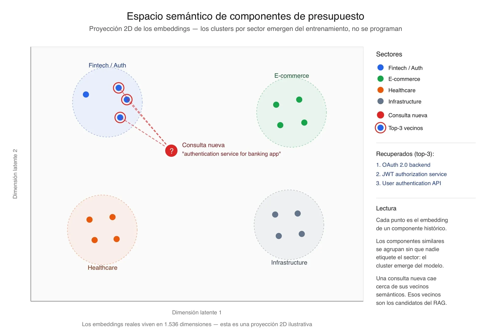
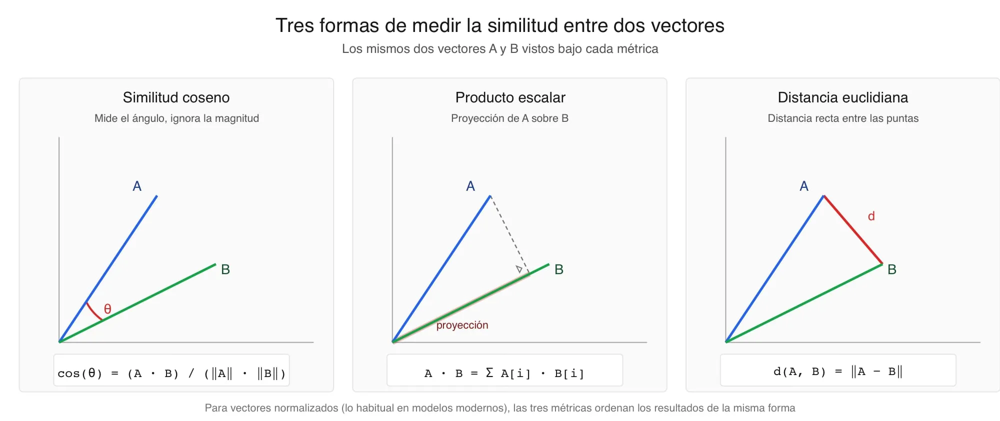
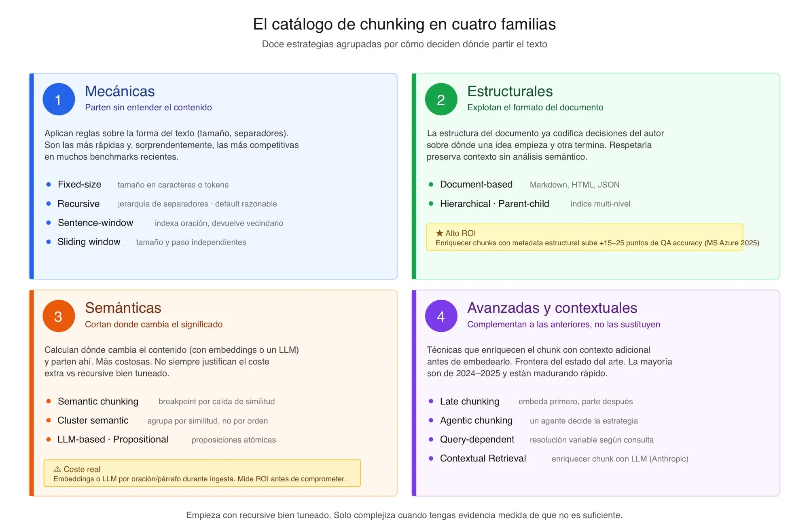

# Sesión 07 — Embeddings y estrategias de chunking (contexto)

> Contexto para preparar la clase, sacado del repo (ramas `session_07` y `session_07_live`).
> Falta añadir la descripción oficial, los artículos y el guion del directo de LIDR
> (el guion de Antonio vive en `guides/session-7-live-guide.md`, que no está en git).

- **Ramas:** `session_07` (punto de partida, el ejercicio previo resuelto) y `session_07_live`
  (estado final del directo).
- **Calendario:** Sesión 7 - Embeddings y representación vectorial (cohorte AI Engineering 2609).
- **Local:** worktree `ai-engineering-fork-julian\ai-engineering-s07`, proyecto docker
  `aieng-s07live` (ver apartado 5).

---

## 1. De qué va

La S6 dejó un corpus **limpio, validado y pseudonimizado**. La S7 da el primer paso hacia la
búsqueda semántica: **convertir ese corpus en vectores**. Dos preguntas centrales:

1. **¿Cómo se trocea un documento?** (chunking): ocho estrategias comparadas sobre el mismo
   corpus, con sus números de tamaño, coste y calidad de recuperación.
2. **¿Qué es un embedding y cómo se mide la "cercanía"?** Similitud coseno, el modelo
   `text-embedding-3-small` (1536 dimensiones) y la reducción de dimensiones (Matryoshka, 768).

**Nada se persiste todavía**: los vectores viven en memoria. La persistencia en pgvector, la
búsqueda real y las métricas formales (recall@k, NDCG) son la **Sesión 8**.

## 2. Ejercicio previo (rama `session_07`)

El pipeline de embeddings mínimo, en `app/generation/rag/` (antes `app/embedding_pipeline/`):

- **`JSONStructuralChunker`**: chunking estructural, **un componente del presupuesto = un
  chunk**, con una cabecera de contexto del presupuesto padre (proyecto, sector, tecnología)
  para que no pierda a quién pertenece. Cuenta tokens con `tiktoken`.
- **`OpenAIEmbedder`**: `text-embedding-3-small`, en lotes de 100, con reintento exponencial
  (1 s / 2 s / 4 s) ante `RateLimitError`.
- **`POST /embeddings/ingest`**: `{"budgets": [...]}` → chunks con su vector y estadísticas.
  Con el sample: 15 presupuestos → 52 chunks → ~4,1k tokens → **~0,00008 $**.
- **`scripts/compare.py`**: similitud coseno entre dos textos, calculada a mano (sin numpy).

**El sanity check** (`app/generation/rag/SANITY_CHECK.md`) da tres números muy buenos para
clase:

| Pareja | Coseno | Lectura |
|---|---|---|
| A · cercanas ("OAuth/JWT fintech" vs "JSON Web Tokens banca") | **0,596** | mismo concepto, casi sin palabras en común: se queda justo por debajo de 0,6 |
| B · sin relación (auth fintech vs migración MySQL→PostgreSQL) | **0,192** | se separan claramente |
| C · genéricas ("Backend services" vs "API development") | **0,541** | **casi tan "cercanas" como la A**: el texto corto y vago no discrimina |

→ La pareja C es la que justifica la **cabecera de contexto** del chunker: sin ella, muchos
componentes caerían en la misma zona difusa "de backend". Y los umbrales de similitud dependen
del modelo y de la redacción: no son constantes universales.

## 3. El directo (rama `session_07_live`)

### 3.1 Ocho estrategias de chunking tras una interfaz común

`app/generation/rag/chunking/base.py::Chunker`, estrategias en `chunking/strategies/`:

| Estrategia | Idea | Coste |
|---|---|---|
| `structural` | un componente del presupuesto = un chunk, con cabecera de contexto | gratis |
| `fixed_size` | trozos de N tokens | gratis |
| `recursive` | separadores jerárquicos (párrafo → frase → palabra), LangChain | gratis |
| `sentence_window` | una frase por chunk + ventana de contexto alrededor (NLTK) | gratis |
| `hierarchical` | chunks padre e hijo | gratis |
| `semantic` | corta donde cambia el significado (embeddings de OpenAI) | barato |
| `propositional` | un LLM reescribe el texto en proposiciones atómicas (`gpt-4o-mini`) | caro y lento |
| `contextual_retrieval` | técnica de Anthropic: un LLM añade a cada chunk su contexto en el documento (`claude-sonnet-4-5`) | caro y lento · **necesita clave de Anthropic** |

*Late chunking* se trata solo como concepto (necesita embeddings a nivel de token).

### 3.2 Números reales (informe de respaldo `app/generation/rag/COMPARISON_REPORT.md`)

| Estrategia | Chunks | p50 tokens | Huérfanos (<20) | Obesos (>800) | Coste | Segundos |
|---|---|---|---|---|---|---|
| structural | 60 | 78 | 0 | 1 | 0 $ | 0,0 |
| fixed_size | 63 | 79 | 0 | 0 | 0 $ | 0,0 |
| recursive | 23 | 187 | 1 | 0 | 0 $ | 0,0 |
| sentence_window | 78 | 21 | **34** | 0 | 0 $ | 0,0 |
| semantic | 34 | 112 | 0 | 1 | 0,0001 $ | 5 |
| propositional | **778** | 11 | **765** | 0 | 0,008 $ | **173** |
| contextual_retrieval | 60 | 132 | 0 | 1 | **0,14 $** | **203** |
| hierarchical | 77 | 81 | 0 | 2 | 0 $ | 0,0 |

Lecturas para clase:

- **`propositional`** genera 13× más chunks, casi todos minúsculos, y tarda 3 minutos; a cambio
  da las similitudes más altas en consultas concretas ("real-time inventory sync" → 0,82).
- **`contextual_retrieval`** es la más cara (0,14 $ por 15 presupuestos) y lenta; mejora la
  similitud del chunk correcto sin cambiar el número de chunks.
- **`sentence_window`** produce muchos huérfanos (frases sueltas) pero acierta muy bien en
  consultas puntuales.
- **`structural`, `fixed_size` y `hierarchical`** coinciden en el top-k porque el corpus ya es
  estructurado: con datos bien preparados (S6), lo simple funciona.

### 3.3 Herramientas de la demo

- **CLI** `scripts/compare_chunkers.py` (la que usa el mentor): estadísticas, coste, top-k por
  consulta y comparación de dimensiones (`--models small-1536,small-768`).
- **API** `POST /embeddings/compare`: `{"budgets", "queries", "strategies", "top_k"}`.
- **Web: el Chunking Lab** en Rails (`/rag/chunking_comparisons`): formulario con las ocho
  estrategias (marca cuáles son de pago), consultas libres y top-k; cada ejecución **se guarda**
  para no volver a pagar las estrategias caras. Timeout de 600 s.
- **Web: la pestaña "Ajustes"** (`/ai_settings`): cambiar en caliente los modelos (incluidos los
  de los chunkers de pago) sin reiniciar.
- Consultas de prueba (`data/test_queries.json`): OAuth fintech, inventario en tiempo real,
  GDPR y auditoría, rendimiento de base de datos, dashboard con gráficos, pasarela de pago.

### 3.4 Reorganización del código

La rama `session_07_live` también **reorganiza todo el servicio** en capas: `foundation/`,
`domain/`, `generation/` (`cag/`, `rag/`, `agentic/`, `conversation/`), `ingestion/` y `api/`,
con su `ARCHITECTURE.md`. En Rails, los modelos se agrupan por contexto (`estimation/`,
`rag/`, `conversation/`). No cambia el comportamiento.

## 4. Dependencias nuevas

`tiktoken` (ejercicio) y `langchain-text-splitters`, `langchain-experimental`,
`langchain-openai`, `nltk` (directo). Sin numpy, scikit-learn ni `sentence-transformers`: el
coseno y los percentiles se calculan con la librería estándar.

## 5. En local (notas de montaje)

- Worktree `ai-engineering-s07`, rama `session_07_live_local`; proyecto `-p aieng-s07live`,
  contenedores `s07-*`.
- Parches locales sin commitear: Dockerfile con torch-CPU + `es_core_news_md` + datos de NLTK
  precargados; override con nombres `s07-*` y montaje de `evals/`; `.env` con la clave de
  OpenAI; scripts de Rails a LF.
- **`contextual_retrieval` no funciona sin `ANTHROPIC_API_KEY`** (el código usa el cliente de
  Anthropic directamente). Para esa estrategia, usar los números del informe de respaldo.

## 6. Material oficial de LIDR

### 6.1 El ejercicio previo de la S7: "Pipeline mínimo de embeddings y chunking"

**Objetivo:** construir en el servicio IA un pipeline mínimo que reciba presupuestos JSON, los
trocee respetando su estructura, genere embeddings con OpenAI y devuelva los vectores; y cerrar
con un script que compruebe que los embeddings discriminan bien. La sesión en vivo parte de
aquí para introducir otras estrategias de chunking y compararlas.

**Entra / no entra:**

| Entra | No entra (es el directo o sesiones posteriores) |
|---|---|
| Chunker estructural (un componente = un chunk) | Otras estrategias: recursive, semantic, hierarchical, late chunking, contextual retrieval… |
| Embedder con `text-embedding-3-small` | Comparar varios modelos de embeddings |
| `POST /embeddings/ingest` | Enriquecer chunks con contexto generado por LLM |
| `scripts/compare.py` (coseno) | Persistencia vectorial (S8), retrieval, recall@k / NDCG |
| Validación con tres parejas | Cambios en la interfaz o en el backend de negocio |

**Datos:** `data/budgets_sample.json`, 15 presupuestos normalizados (fintech, e-commerce,
healthcare, industrial), cada uno con `client_metadata`, `project_summary`, `main_technology`,
`year` y una lista de `components` (`component_id`, `name`, `description`, `tech_stack`,
`estimated_hours`, `complexity`, `dependencies`).

**Los siete pasos:**

1. **Estructura y dependencias**: módulo `app/embedding_pipeline/` (`chunker.py`, `embedder.py`,
   `schemas.py`, `router.py`) + `scripts/compare.py`. Solo `openai` y `tiktoken`: **nada de numpy
   ni scikit-learn**, el coseno se calcula a mano.
2. **Modelos Pydantic v2**: `BudgetComponent`, `Budget`, `Chunk` (`chunk_id`, `text`, `metadata`,
   `token_count`), `EmbeddedChunk` (+ `embedding`), `IngestRequest`, `IngestResponse` (`chunks` +
   `stats`: `total_budgets`, `total_chunks`, `total_tokens`, `estimated_cost_usd`). Nombres en
   inglés y `Literal` cerrados donde se conozca el universo de valores.
3. **Chunker estructural** (`JSONStructuralChunker.chunk`):
   - Un componente del presupuesto = un chunk.
   - El `text` antepone el contexto del padre:
     ```
     [Project: {project_summary}]
     [Client sector: {sector} | Year: {year} | Main tech: {main_technology}]

     Component: {name}
     Description: {description}
     Tech stack: {tech_stack}
     Complexity: {complexity}
     Estimated hours: {estimated_hours}
     ```
     Es deliberado: sin él, un "Authentication backend" pierde a qué cliente y sector pertenece
     (*contextual chunk headers*, artículo 3).
   - **Metadata filtrable que NO se embebe**: `budget_id`, `component_id`, `client_sector`,
     `main_technology`, `year`, `complexity`, `estimated_hours`.
   - `chunk_id` = `{budget_id}::{component_id}` (trazable).
   - `token_count` con `tiktoken.encoding_for_model("text-embedding-3-small")`, para detectar
     chunks anormalmente grandes.
   - Sin overlap ni troceo por tamaño: si una descripción es muy larga, **es material para el
     directo** (en el informe, `structural` tiene 1 chunk "obeso" de 1391 tokens).
4. **Embedder** (`OpenAIEmbedder.embed_one` / `embed_many`): 1536 dimensiones por defecto
   (Matryoshka es del directo); **lotes de 100 chunks** por llamada "para no martillear la API";
   `RateLimitError` con 3 reintentos (1 s, 2 s, 4 s); log con `structlog` por lote (chunks,
   tokens, latencia); coste con el precio como constante etiquetada (**0,02 $ por millón de
   tokens**).
5. **Endpoint** `POST /embeddings/ingest`: `chunk → embed_many → IngestResponse`; 200 / 422 /
   500 (mensaje genérico al cliente, detalle en logs); visible en `/docs`.
6. **`compare.py`**: dos textos → coseno (producto escalar / producto de normas, a mano);
   ejecutable dentro y fuera del contenedor.
7. **`SANITY_CHECK.md`** con tres parejas fijas:
   - **A**, cercanas: se espera > 0,6.
   - **B**, sin relación: se espera < 0,4.
   - **C**, genéricas: sin expectativa fija.

   Hay que comentar el resultado.

**Entregable:** rama `session-07/pre-exercise` con el módulo, el script, el endpoint, el
`SANITY_CHECK.md`, el README actualizado y el `pyproject.toml`. Los tests no son requisito.

> 🎯 **Para clase:** la pareja A da **0,5957**, por debajo del 0,6 orientativo. Es lo que
> reporta Gabriel (ver [dudas-alumnos.md](dudas-alumnos.md)) y lo que sale en la rama oficial.
> Buen arranque: los umbrales dependen del modelo, de la redacción y de la métrica.
>
> 🎯 **La duda de Miguel Ángel** sobre agrupar llamadas sale del paso 4 (lotes de 100).

### 6.2 El ejercicio de límites del CAG (puente S5 → S6)

Venía pegado con el título de la S7, pero su contenido es el ejercicio que justifica pasar de
CAG a RAG. Lo guardo porque sus números son los que se recogen al empezar la S6.

**Objetivo:** vivir empíricamente por qué el CAG no escala cuando el contexto deja de ser
pequeño y curado. Los datos crecen en volumen, heterogeneidad y sensibilidad.

**Dataset:** ~80 presupuestos JSON anidados + ~10 transcripciones de kick-off (200–600 palabras)
+ `MANIFEST.md`. **~250K tokens** a propósito: incómodo para modelos de 32K–128K y con fricción
de coste y latencia incluso para 200K+. Ya viene pseudonimizado.

**Entregables:**

- `scripts/measure_corpus.py` → `output/corpus_metrics.json` con modelo, ventana, tokens
  totales y por fuente, `fits_in_context` y `context_usage_pct`.
- `scripts/run_cag_battery.py` → 6 queries fijas, 2 ejecuciones cada una, con respuesta,
  latencia, tokens y coste.
- Una rúbrica de calidad del 1 al 5 por ejecución.
- `CAG_LIMITS.md`: configuración, tabla de resultados y hallazgos.
- `CAG_TO_RAG.md`: qué pasa a RAG y qué se queda en CAG, granularidad, metadatos y riesgos.

**Las 6 queries fijas** (si el contexto se excede, el error es el hallazgo):

1. **Factual simple:** coste y cliente del proyecto `PRJ-2023-047`.
2. **Agregada con filtro:** los 5 proyectos más caros de migración a microservicios.
3. **Razonamiento cross-document:** riesgos recurrentes con stack legacy (.NET Framework,
   Java < 8, PHP < 7).
4. **Temporal:** evolución de las estimaciones medias de proyectos RAG/LLM desde 2023.
5. **Needle in a haystack:** ¿algún cliente exigió despliegue on-premise por compliance en los
   kick-offs?
6. **Síntesis:** precedentes y rango de coste/duración para modernizar un monolito Java a
   microservicios en banca.

**Rúbrica de calidad:**

| Nota | Significado |
|---|---|
| 5 | Correcta, completa y verificable, citando precedentes |
| 4 | Correcta pero incompleta o sin trazabilidad |
| 3 | Mezcla información correcta e incorrecta |
| 2 | Vaga o generalista |
| 1 | Incorrecta, alucinada o declara que no puede responder |

La evaluación sistemática con RAGAS llega en la S11.

**Hallazgos que se piden:**

- ¿Cabe el corpus?
- ¿Qué tipo de query degrada más?
- ¿Dónde alucina, con el fragmento literal?
- ¿Cuánto costaron las 12 ejecuciones?
- La proyección a **1.000 consultas/día durante un mes**, calculada y no estimada a ojo.

Fuera de alcance: pipeline de ingesta formal, anonimizar, PDF/DOCX, el `Document` canónico,
Pandera, Presidio, `unstructured`, reescribir el CAG. *"Si te sorprendes implementando algo de
la lista anterior, para."*

### 6.3 Artículo 1 — Embeddings: del texto a la geometría semántica

**El problema:** cuando llega un brief como *"servicio de autenticación con OAuth para una app
móvil financiera"*, el sistema debe encontrar los componentes históricos relevantes **aunque no
compartan ninguna palabra**: "authentication service" debe encontrar "OAuth 2.0 backend", "JWT
authorization module" o "single sign-on". Eso es búsqueda semántica.



**Qué es un embedding:** una función texto → vector de dimensión fija:

| Modelo | Dimensiones |
|---|---|
| `text-embedding-3-small` | 1536 |
| `all-MiniLM-L6-v2` | 384 |
| `text-embedding-3-large` | 3072 |

La propiedad que importa: **textos parecidos → vectores cercanos**. Ninguna dimensión suelta
significa nada legible (la 142 no es "lo fintech"); lo que tiene significado son las
**direcciones y las distancias relativas**.

**Cómo aprenden la geometría — aprendizaje contrastivo:**

- El entrenamiento usa millones de tripletes **ancla / positivo / negativo**.
- Se castiga que el ancla quede más cerca del negativo que del positivo.
- Lo que cuenta como "positivo" define qué entiende el modelo por "similar": paráfrasis,
  traducciones, pregunta-respuesta, código equivalente…
- Consecuencia práctica: un modelo entrenado con inglés general rinde menos con presupuestos
  técnicos en español con jerga financiera.
- **Nadie programa las dimensiones: emergen.** Se trata como caja negra cuyas distancias
  funcionan, y se mide con benchmarks.
- El clásico `rey − hombre + mujer ≈ reina` es de Word2Vec. Con embeddings modernos de frases
  casi nunca sale tan limpio.

**Las tres métricas:**



| Métrica | Fórmula | Rango | Rasgo |
|---|---|---|---|
| **Coseno** | `(A · B) / (‖A‖ × ‖B‖)` | −1 a 1 (en texto, 0 a 1) | mide el **ángulo**, ignora la magnitud: un documento largo no sale penalizado frente a una consulta corta |
| **Producto escalar** | `Σ A[i] × B[i]` | sin acotar | más barato (sin normas) |
| **Euclidiana** | `√Σ (A[i] − B[i])²` | 0 a ∞ | distancia recta entre las puntas |

- `text-embedding-3-small` devuelve **vectores normalizados** (norma 1). Por eso **producto
  escalar = coseno**, y muchas bases vectoriales usan el producto escalar.
- Con vectores normalizados, `euclídea² = 2 − 2 × coseno`: las tres ordenan igual.
- **Regla para elegir métrica:** la que se usó al entrenar el modelo (lo dice la *model card*).
  No es una decisión arquitectónica.
- El artículo implementa las tres en Python puro, en unas treinta líneas y sin numpy.

**Ejemplo del artículo (tres parejas):** "User authentication API with role-based access
control" frente a:

- "Login service backend with permission management" → se espera **alta**;
- "Real-time WebSocket chat module" → **más baja**;
- y una pareja ambigua de rendimiento frente a caché.

Lo importante es **la estructura del resultado** (la pareja 1 claramente por encima de la 2), no
los números absolutos. Si las tres dieran parecido, el modelo no discrimina en tu dominio.

**Lo que un embedding NO resuelve:**

1. **Números, fechas e identificadores.** "Presupuestos de 2024" se resuelve con **filtros sobre
   el metadata**, no con similitud.
2. **Coincidencias exactas de palabras raras** (nombres propios). Ahí BM25 gana; por eso existe
   la búsqueda híbrida (S10).
3. **La maldición de la dimensionalidad.** Las distancias entre pares aleatorios se concentran,
   así que **0,2–0,5 entre textos sin relación es normal**. Calibra los umbrales con tu dataset:
   `> 0,7` no significa "muy similar" en absoluto.
4. **El modelo importa mucho más que la métrica.** Pasar de coseno a producto escalar no cambia
   nada; pasar de un modelo solo-inglés a uno multilingüe, sí.

### 6.4 Artículo 2 — Selección de modelos de embeddings (llegó incompleto)

**El panorama en mayo de 2026:**

| Modelo | Tipo | Dimensiones | Precio / M tokens | Notas |
|---|---|---|---|---|
| OpenAI `text-embedding-3-small` | API | 1536 (Matryoshka hasta 256) | 0,02 $ | el caballo de batalla; MTEB ≈ 62 |
| OpenAI `text-embedding-3-large` | API | 3072 (Matryoshka hasta 256) | 0,13 $ | mejor calidad, 6,5× más caro |
| Cohere `embed-v3` | API | — | 0,10 $ | muy fuerte en multilingüe; reranking integrado |
| Voyage `voyage-3-large` | API | — | similar a Cohere | optimizado para retrieval |
| `BAAI/bge-m3` | open source (MIT) | 1024 | 0 $ (necesita GPU) | multilingüe; dense, sparse y multi-vector |
| `all-MiniLM-L6-v2` | open source (Apache 2.0) | 384 | 0 $ (corre en CPU) | inglés; MTEB ≈ 56; ideal para prototipos |

Precios y scores cambian cada pocos meses: verificar antes de decidir.

**Cinco criterios de decisión:**

1. **Dimensionalidad.** Con miles de vectores da igual; con cientos de millones, pasar de 1536 a
   768 decide si cabe en RAM.
2. **Idioma.** Los componentes están en inglés, pero los briefs futuros vendrán en español: hace
   falta un modelo multilingüe.
3. **Dominio.** No hay un modelo público de "presupuestos de software": se usa uno generalista y
   se valida sobre nuestros datos.
4. **Hosting y coste.** API frente a self-hosted. Por debajo de unos 20 M tokens/mes, la API
   suele salir más barata; con volumen alto y datos sensibles, gana el self-hosted.
5. **Licencia.** Si por contrato ningún dato puede salir de la infraestructura del cliente
   (banca, sanidad, defensa), solo vale self-hosted.

Qué eje pesa más depende del contexto: en una startup, coste; en sanidad, licencia y privacidad.

*Faltan las partes de MTEB, Matryoshka y la decisión final del artículo (`text-embedding-3-small`
y cuándo no lo sería).*

### 6.5 Artículo 3 — Estrategias profesionales de chunking



**Por qué importa:**

- Un presupuesto entero en un solo embedding es un promedio difuso.
- Trozos demasiado pequeños pierden el contexto.
- Cortar por carácter rompe ideas.

Tres datos que lo cuantifican:

- **Vectara (NAACL 2025)**, 25 configuraciones × 48 modelos: cambiar el chunking mueve **tanto
  como cambiar de modelo**.
- **Chroma (2025):**
  - LLM semantic → recall 0,919;
  - cluster semantic → 0,913;
  - recursive bien tuneado (400 tokens) → 0,88–0,89.
- **Vecta (febrero 2026):** recursive de 512 tokens, primero con un **69 %**; semantic,
  **cuarto con un 54 %**. Más sofisticado no significa mejor.

→ **Mide sobre tus datos antes de comprometer arquitectura.**

**Las cuatro familias (doce estrategias):**

| Familia | Cómo deciden | Estrategias | Cuándo / cuándo no |
|---|---|---|---|
| **1 · Mecánicas** | reglas sobre la forma del texto, sin entenderlo | **fixed-size** (con overlap del 10–20 %), **recursive** (jerarquía de separadores `\n\n` → `\n` → `. ` → ` `), **sentence-window** (indexa la frase, devuelve su vecindario), **sliding window** | rápidas y muy competitivas; recursive es el *default* razonable. Fallan con estructura formal (JSON, código) |
| **2 · Estructurales** | explotan el formato del documento | **document-based** (Markdown, HTML; JSON siempre a medida), **hierarchical / parent-child** (indexa hijos y devuelve padres) | ⭐ **alto ROI**: metadata estructural = **+15–25 puntos** de precisión en QA (Microsoft Azure 2025). Parent-child es **una decisión de arquitectura**, no solo de chunking |
| **3 · Semánticas** | cortan donde cambia el significado | **semantic** (caída de similitud entre frases consecutivas), **cluster semantic** (agrupa por similitud aunque no sea consecutivo; rompe la trazabilidad), **LLM-based / propositional** | caras: embeddings o un LLM por frase en la ingesta. **Mide el ROI** |
| **4 · Avanzadas y contextuales** | complementan a las anteriores, no las sustituyen | **late chunking** (Jina 2024: embebe todo y luego corta; necesita embeddings por token), **agentic** (un agente elige la estrategia), **query-dependent** (AI21 2026: varias resoluciones a la vez), **Contextual Retrieval** (Anthropic) | la frontera del estado del arte, de 2024–2025 |

**Contextual Retrieval (Anthropic):**

- Un LLM escribe un párrafo que **sitúa cada chunk en su documento**, y se antepone antes de
  embeber y de indexar en BM25.
- Fallos de retrieval: **−35 %** solo con esto, **−49 %** con BM25 contextual y **hasta −67 %**
  con reranking.
- Con *prompt caching* sale por **~1 $ por millón** de tokens.
- Es "la que vale la pena implementar de inmediato si tu RAG ya funciona pero no termina de
  afinar".

**Los siete criterios honestos para elegir:**

1. Empieza con **recursive, 400–512 tokens y 10–20 % de overlap**.
2. Si hay estructura, úsala (la palanca de mayor ROI).
3. Si los chunks pierden sentido al aislarlos, Contextual Retrieval.
4. Semantic y LLM-based, solo justificadas con datos.
5. Parent-child, solo con un pipeline plano que ya funcione.
6. Late, agentic y query-dependent: estar al tanto, no meterlas en producción sin un caso.
7. **El mejor chunking depende del tipo de documento**: un corpus heterogéneo pide estrategias
   distintas.

### 6.6 Artículo 4 — Chunking aplicado al proyecto

Dos tipos de documento con estructura radicalmente distinta, así que **dos chunkers tras una
interfaz común** (`Chunker.chunk`), no uno genérico lleno de condicionales:

**Presupuestos JSON → `JSONStructuralChunker`.** Por qué fallan los splitters genéricos:

- cortan en mitad de una clave (`"client_metadata": {"sector":` | `"finance", …`);
- pierden la jerarquía padre-hijo;
- serializar a texto plano borra la estructura.

Tres decisiones:

1. **Granularidad: un componente = un chunk.** Es la unidad de razonamiento del negocio.
2. **Texto legible + cabeceras de contexto del padre** (los *contextual chunk headers*): la
   versión **estática y barata** de Contextual Retrieval, sin LLM.
3. **Metadata filtrable que no se embebe**: sector, año, tecnología, complejidad, horas.

**Transcripciones → `TopicSegmentationChunker`.** Son 6.000–12.000 tokens sin estructura, con
hablantes alternos y temas que van y vuelven. Con recursive de 512 tokens, los cortes caen en
mitad de una intervención. Tres decisiones:

1. **Un bloque temático = un chunk.** Se corta cuando la similitud entre intervenciones
   consecutivas cae por debajo de un umbral (**0,55** como punto de partida, a calibrar).
2. **Cabecera con los datos de la reunión**: cliente, fecha, fase y hablantes.
3. **Metadata temporal y de hablante.**

Para segmentar se usa `all-MiniLM-L6-v2` en local, porque es barato y rápido con muchas frases;
el índice final sigue con `text-embedding-3-small`. **Distintas piezas pueden usar distintos
modelos.**

**El metadata enrichment, la palanca subestimada** (+15–25 puntos), funciona de tres formas:

- **Cabeceras dentro del texto**: pesan en el vector.
- **Metadata fuera del texto**: para filtrar en pgvector en la S8, por ejemplo
  `sector = 'finance' AND year >= 2024` junto con la búsqueda vectorial.
- **IDs trazables** (`{budget_id}::{component_id}`): para citar la fuente, auditar e invalidar
  chunks.

**La regla para decidir dónde va cada dato:**

- **En el texto**, si cambia el significado para una consulta natural.
- **En el metadata**, si es discreto y sirve para filtrar.
- **En los dos**, si cumple ambos papeles (el sector, por ejemplo).

**Composición:** `POST /embeddings/ingest` con un campo `document_type` (`budget` /
`transcript`) y un `IngestRouter` que elige el chunker. Que el tipo venga explícito es más simple
y auditable que detectarlo solo (eso sería *agentic chunking*). El backend (Rails o cualquier
cliente HTTP) solo envía el documento con su tipo.

> 🎯 **Diferencia con el código del directo:** la rama `session_07_live` no implementa
> `TopicSegmentationChunker` ni el `document_type`. Lo que trae son **ocho estrategias** sobre los
> presupuestos y el comparador. El segmentador de transcripciones es diseño del artículo.

## 7. Material para clase

| Pieza | Fichero | Qué es |
|---|---|---|
| Plantilla base de LIDR | [`deck/plantilla-lidr-s07.pdf`](deck/plantilla-lidr-s07.pdf) | 12 páginas oficiales: portada, tres arquitecturas, cinco patrones de error, Matryoshka, cuatro familias, fixed vs recursive, sentence-window vs structural, Contextual Retrieval, hierarchical, cierre/S8, ROTI y gracias |
| Versión de Julián | [`Sesion07-Julian-Fernandez.pdf`](Sesion07-Julian-Fernandez.pdf) | 44 diapos, un solo PDF para todos (sin versión mentor ni PPTX): las 12 de la plantilla + 32 propias con los números reales del corpus, incluidas las de vocabulario (chunk, token, vector), las columnas del Chunking Lab (p50, p95, huérfanos, obesos), por qué no se comparan vectores de distinta dimensión y **una diapo por cada una de las 8 estrategias del código** (diagrama con un ejemplo real + la idea, cuándo usarla y cuidado con) |
| Generador | [`deck/build_deck.py`](deck/build_deck.py) | `python build_deck.py` regenera el PDF; rasteriza los SVG con Edge headless |
| Diagramas de estrategias | [`deck/diagramas_estrategias.py`](deck/diagramas_estrategias.py) | genera `assets/s07-est-*.svg` con ejemplos sacados de ejecutar las estrategias reales (semantic y propositional con OpenAI; el párrafo de Contextual Retrieval es ilustrativo, sin clave de Anthropic) |
| Guion oficial | [`guion-directo.md`](guion-directo.md) | el guion de LIDR con la nota de cómo se lanza en local |

Diagramas nuevos en `curso-master/assets/` (SVG fuente + PNG): `s07-pipeline-hoy`, `s07-anatomia-chunk`
`s07-late-chunking` y `s07-tamano-chunks` (distribución de tamaños por estrategia). Se reutilizan además `s07-espacio-semantico.png`, `s07-metricas-similitud.png`
y `s07-familias-chunking.png` (los del artículo).

Los números de las diapos de mecánicas son los de la ejecución en local (`--output-table`:
fixed 0,4760 · recursive 0,3991 · sentence_window 0,5366 · structural 0,4734); el resto, los del
informe `COMPARISON_REPORT.md`.

## 8. Pendiente

- [ ] El final del artículo 2 (MTEB, Matryoshka y decisión).
- [x] Deck de la S7 sobre la plantilla de LIDR.
- [ ] Guion personal de Julián.
